# SightSense

A smart guide cane for people who are blind or have low vision. You say where you want to go ("guide me to the apple", "take me to the door"), and a small wheel at the tip of the cane steers you there while avoiding obstacles.

Built at the UCSC AI Hackathon @ SF Tech Week, October 10–11, 2026, for the ASUS Local AI track, where it placed 1st overall.

> Experimental prototype. It does not replace a white cane or a guide dog, and it has not been tested with blind users.

## See it in 3D

<a href="https://connorsawaya.github.io/SightSense/">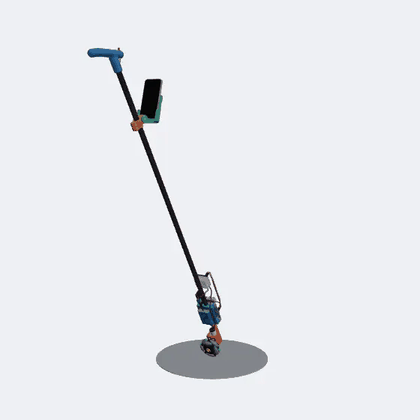</a>

**[Open the interactive model and guided tour](https://connorsawaya.github.io/SightSense/)** (or click the picture): drag to turn it, step through each part, and point at a data line to see what it carries. There is more on the [project page](https://connors.dev/sightsense).

| | |
| --- | --- |
| 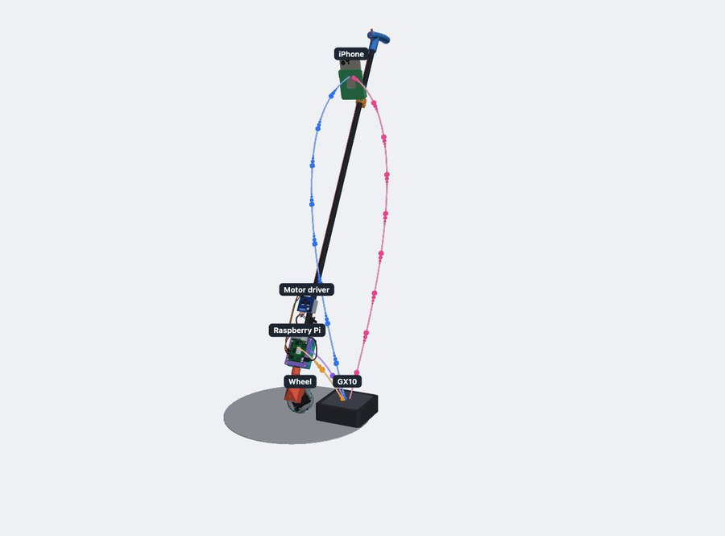 | 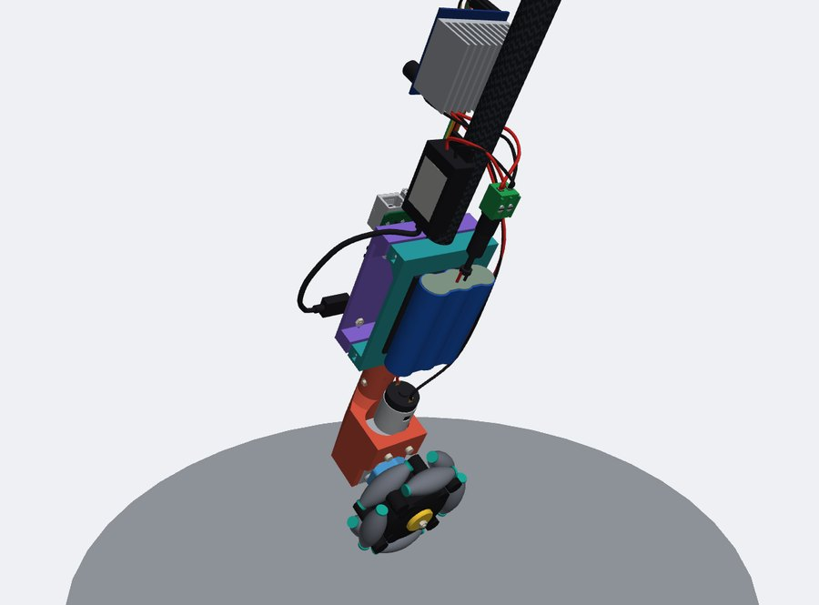 |
| **The wireless links.** Camera frames go from the phone to the GX10, guidance comes back, and one word goes to the Pi. | **The wheel end.** Battery, 5 V converter, motor driver, gearmotor and the 85 mm omni wheel. |
| 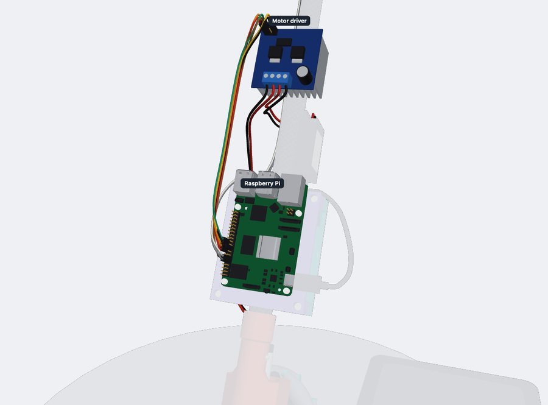 | 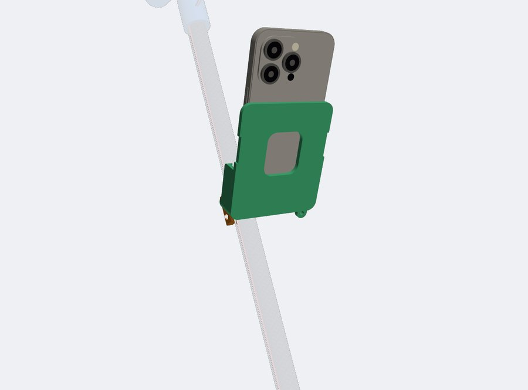 |
| **Pi to driver.** The six signal wires from the Pi's header to the IBT-2. | **Phone mount.** The iPhone in its tilting cradle, camera forward. |

These are pictures of a CAD model, not photos of the cane. The model was drawn on October 12, after the event, from the printable parts in [`hardware/`](hardware/) and the wiring in [`hardware/wiring.md`](hardware/wiring.md). The bought parts in it are drawn from published sizes, not measured, and where the motor driver, converter and adapter sit is made up: no mount is designed for them yet. It shows three tubes; [`hardware/assembly/`](hardware/assembly/) draws four.

## Photos from the event

Taken by the team at the event.

| | |
| --- | --- |
| 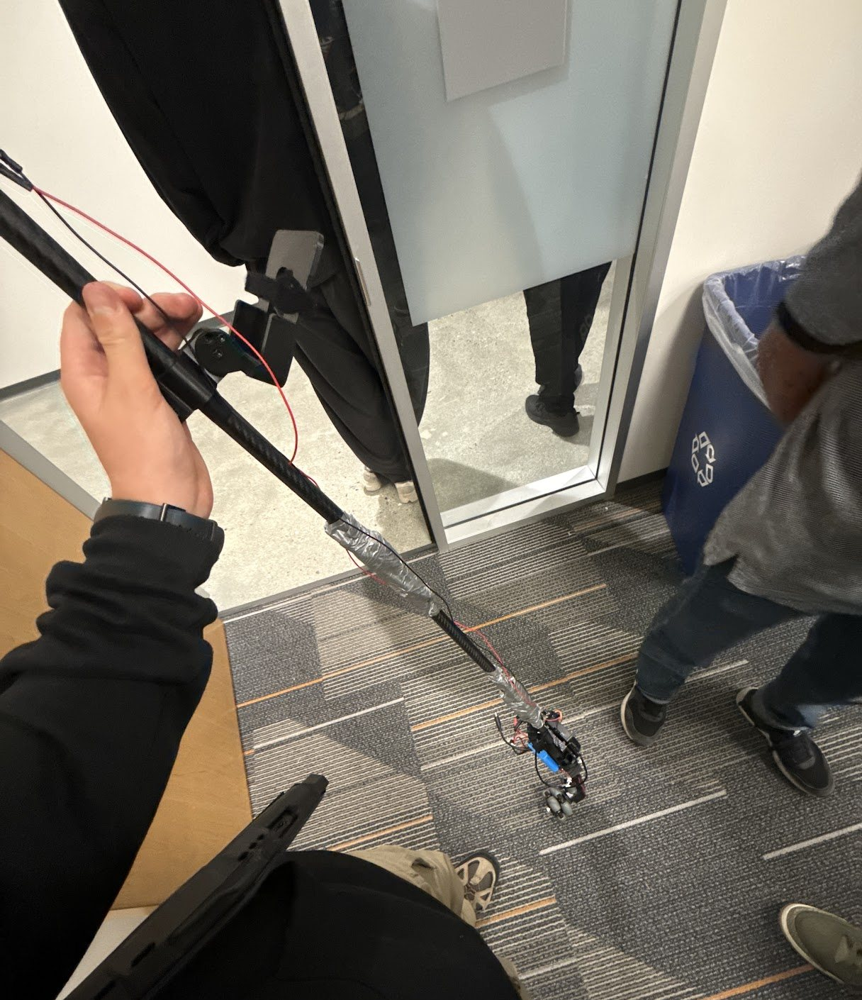 | 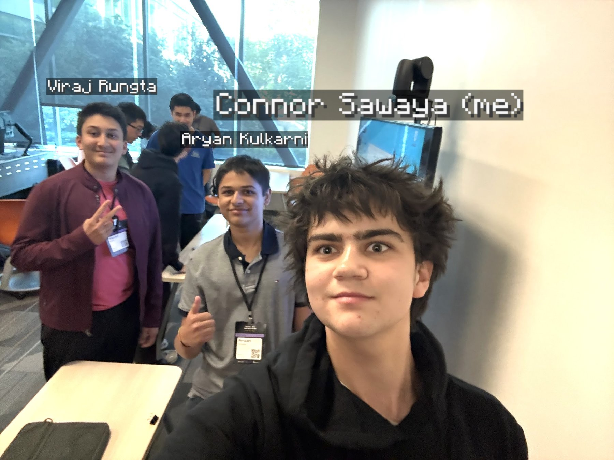 |
| The cane at the event, with the wheel end on the floor. | The team: Viraj Rungta, Aryan Kulkarni and Connor Sawaya. Not pictured: Anshuman Kumar. The name tags were added afterwards. |

| | | | |
| --- | --- | --- | --- |
| 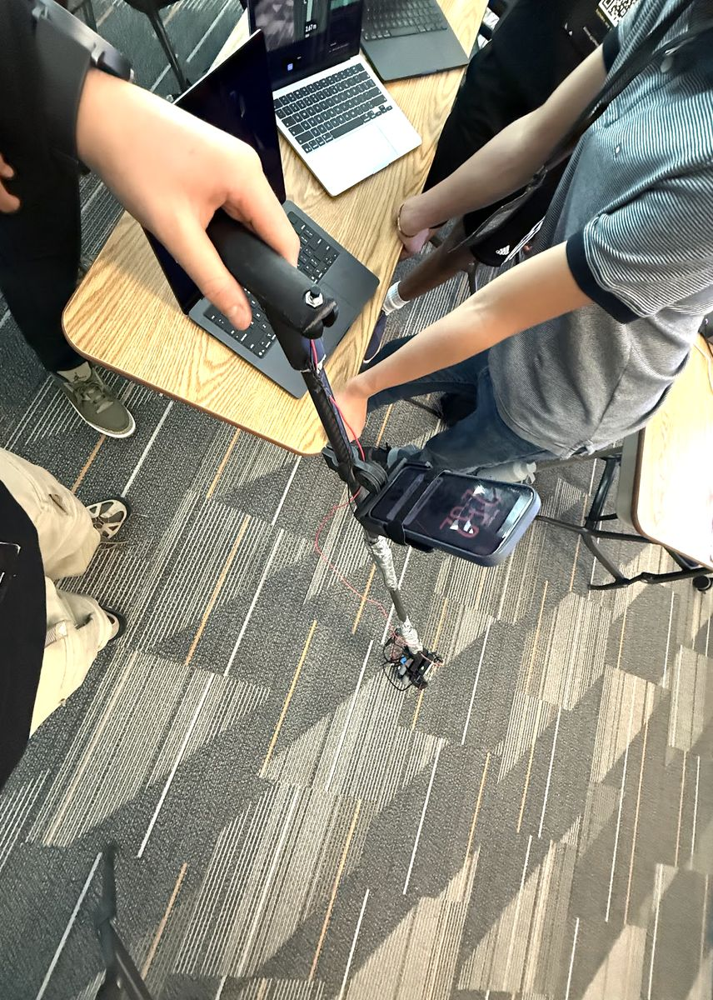 | 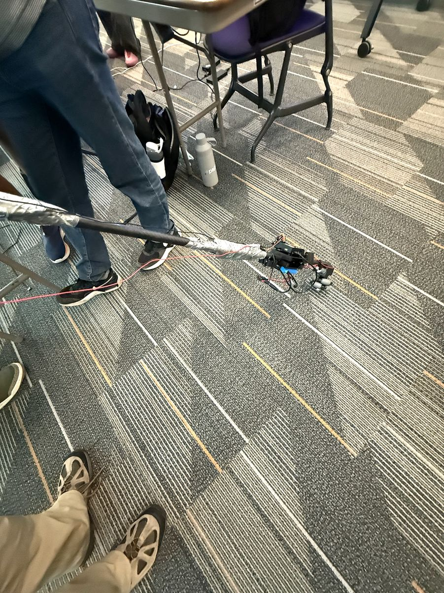 | 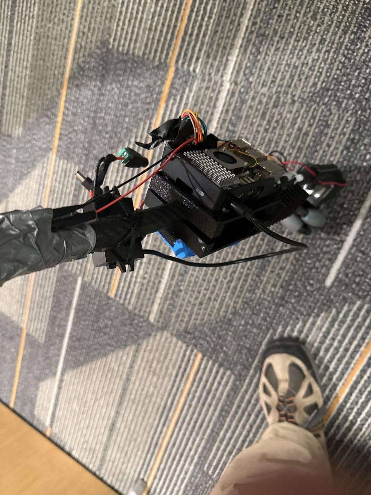 | 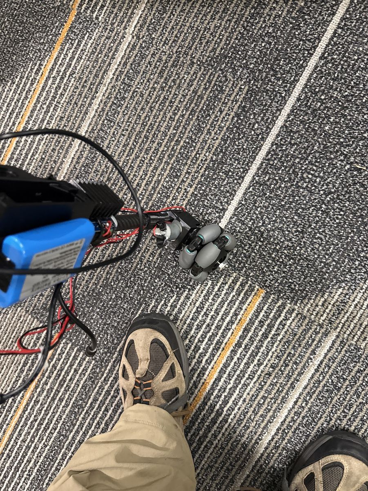 |
| The whole cane in hand: handle, phone mount and wheel. | The wheel end on the floor, with tape over the tube joints. | The Raspberry Pi in its case, the jumper wires, the green power adapter and the battery underneath. | The battery pack, the carbon tube and the omni wheel. |

## How it works

```
iPhone (on the cane)        ASUS GX10 (on the table)           Raspberry Pi (on the cane)
camera + LiDAR + position ─► obstacle check, AI models, ─────► drives the wheel motor
        ▲                    route following                    │
        └── beeps and speech ◄──────┘                           ▼
                                                          mecanum wheel
```

1. The iPhone sends a picture, a LiDAR distance map and its position about 15 times a second.
2. The GX10 checks seven directions for clear space and picks the one closest to where you want to go.
3. The GX10 sends one word to the Pi: `LEFT`, `CENTER`, `RIGHT` or `STOP`.
4. The Pi directly drives the mecanum wheel in opposite directions for LEFT/RIGHT. CENTER/STOP/FREE switch it off. If it hears nothing for 0.4 seconds, it switches the motor off.
5. A vision-language model on the GX10 finds named objects, reads signs and answers questions. It never controls the wheel.

AI and guidance run locally on the GX10. The current devices communicate through the existing Tailscale network; a private router was the original plan. Place lookup uses Apple Maps.

## Repository layout

| Folder | What goes here | Owner |
| --- | --- | --- |
| [`contracts/`](contracts/) | The agreed message formats between the phone, the GX10 and the Pi | Everyone |
| [`ios-app/`](ios-app/) | The iPhone app: capture, sending, speech, voice, maps | iPhone app |
| [`gx10/`](gx10/) | Everything that runs on the GX10: receiving frames, obstacle check, AI models, dashboard | GX10 + models, obstacle check |
| [`pi/`](pi/) | The Raspberry Pi motor controller | Cane + Pi |
| [`hardware/`](hardware/) | 3D-printable parts, wiring and build notes for the cane | Cane + Pi |
| [`docs/`](docs/) | Project history, tool disclosure and supporting notes | Team lead |

## Hardware

- iPhone 16 Pro (camera, LiDAR, ARKit)
- ASUS Ascent GX10 (borrowed from ASUS for the event)
- Raspberry Pi 5
- 12 V 120 rpm DC worm gear motor driving an 85 mm omni wheel, IBT-2 (BTS7960) motor driver. Older notes here call it the mecanum wheel
- 12 V 3 Ah battery pack, fuse, kill switch
- 18 mm carbon-fibre tube cane with a printed keyed coupler (see [`hardware/cane-coupler/`](hardware/cane-coupler/))

The full list, down to the screws, is in [`hardware/BOM.md`](hardware/BOM.md).

## Status

The iPhone and GX10 application code is in. The Pi has direct wheel mode and a one-time SD installer. Software tests use synthetic phone frames, real local WebSockets and mock GPIO. Actual wheel direction, RPM and updated Pi boot remain physical checks; see [`pi/README.md`](pi/README.md).

## Team

Connor Sawaya, Viraj Rungta, Aryan Kulkarni and Anshuman Kumar.

Roles to be added by the team.
