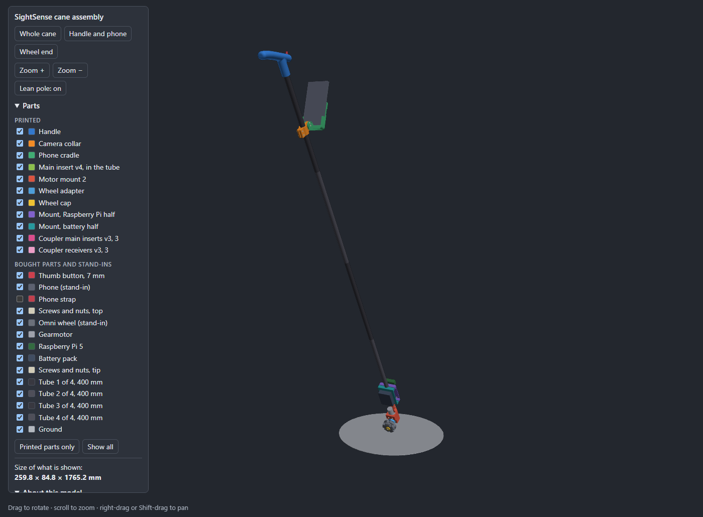
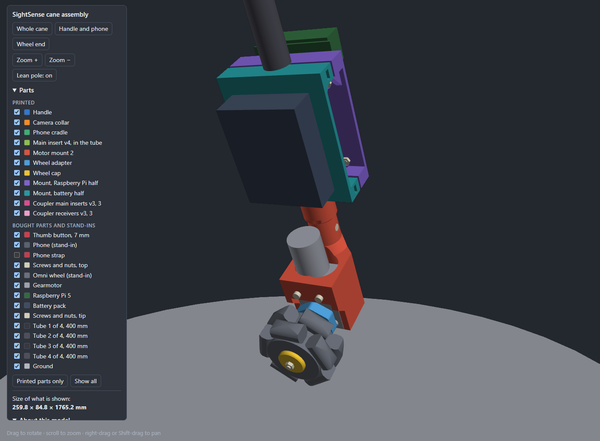

# Whole-cane assembly

An interactive 3D model of the whole cane with every printed part in place: the handle, the phone mount, the keyed couplers that join the four tubes, the main insert, motor mount 2, the wheel adapter and its cap, and the battery and Raspberry Pi mount.

Experimental prototype. Nothing here has been printed, fitted or load tested. The model shows how the parts go together; it is not evidence that they work.





## Opening it

`assembly_viewer.html` is one self-contained file of about 9.5 MB. It needs no internet connection. GitHub does not display it, so download it (or clone the repository) and open it in a browser.

- Drag to rotate, scroll to zoom, right-drag or Shift-drag to pan.
- **Whole cane**, **Handle and phone** and **Wheel end** jump to each view.
- The tick boxes show and hide each part. Hide a tube to see the inserts inside it. The tubes are drawn in two greys in turn, so the joints show.
- **Lean pole** switches between the pole leaning as it is held, standing on the ground, and the pole upright.

## What is in it

| Part | Printed? | Source |
| --- | --- | --- |
| Handle, the plug glued in the tube under it, camera collar, phone cradle | Yes | [`../handle-phone-mount/`](../handle-phone-mount/) |
| Coupler main insert v3 and receiver v3, three of each | Yes | [`../cane-coupler/`](../cane-coupler/) |
| Main insert v4 | Yes | [`../cane-coupler/`](../cane-coupler/) |
| Motor mount 2 | Yes | [`../motor-mount-2/`](../motor-mount-2/) |
| Wheel adapter, wheel cap | Yes | [`../wheel-adapter/`](../wheel-adapter/) |
| Mount for the Raspberry Pi and the battery, two halves | Yes | [`../electronics-mount/`](../electronics-mount/) |
| Thumb button, phone, gearmotor, omni wheel, Raspberry Pi 5, battery pack, four tubes, screws and nuts | No | Drawn as plain shapes for reference |

Left out: the v4 motor receiver (motor mount 2 goes in the same place), the motor driver board, the wiring and the shock cord.

The Raspberry Pi is held by four M2.5 × 12 screws with nuts.

## What is a stand-in or an assumption

| Item | Drawn as | Why |
| --- | --- | --- |
| Tubes | Four sections of 400 mm, 1,600 mm in all | The team's tubes. See the next section for how high that puts the handle |
| Lean of the pole | 30 degrees from upright | The angle the handle was designed for; not measured in use |
| Omni wheel | 58 mm across, 27 mm wide at the hub | Not measured. It looked 50 to 60 mm across in the team's photos |
| Phone | A generic phone | Not measured |
| Gearmotor | JGY-370 outline | From a published drawing, not from measuring this motor |
| Camera collar | 240 mm below the top of the tube | It can be clamped anywhere on the tube |

## The tubes and their joints

The pole is four carbon tubes of 400 mm, 18 mm outside and 16 mm inside, meeting end to end. Each of the three joints is one keyed coupler from [`../cane-coupler/`](../cane-coupler/):

- the tube above carries a v3 main insert, glued in with its barrel flush with the tube's end and its tongue pointing down;
- the tube below carries a v3 receiver, glued in with its mouth flush with the tube's end.

So the joints are 400, 800 and 1,200 mm below the top of the pole, and nothing shows on the outside but the seam. The bottom tube ends in the v4 main insert, which goes into motor mount 2 with its cross bolt.

The script checks each joint: the tongue seats in the socket and both inserts sit inside their tubes, with no overlap. That is a check of the model only.

To print for the three joints: three `PathSense_Keyed_ShockCord_Main_v3.stl` and three `PathSense_Keyed_ShockCord_Receiver_v3.stl`.

**Four tubes make a long cane.** With the pole leaning 30 degrees, which is what the handle is drawn for, the script puts the top of the pole 1.51 m above the ground. That is above shoulder height for most people. The same sum gives about 1.16 m for three tubes and 0.81 m for two. These are calculated from the model with a stand-in wheel, not measured. Set `TUBE_SECTIONS` at the top of the script to draw another length.

## Which way round the wheel end goes

The script checks which part reaches the ground first when the pole leans.

- **Motor on the user's side of the tube:** the wheel reaches the ground first, with 13.7 mm to spare. The model is drawn this way.
- **Motor in front of the tube:** the bottom edge of motor mount 2 is 15.2 mm lower than the wheel, so the mount would touch the ground before the wheel.

Both figures are for a 58 mm wheel and a 30 degree lean. They also assume the wheel's axle points along the walking direction, so that the wheel pushes the tip of the cane left and right.

The coupler's tongue is rectangular, so motor mount 2 goes onto it either way round. Fit it with the motor on the user's side.

Either way the wheel meets the ground tilted by the lean angle, because the motor sits parallel to the tube. Whether the wheel grips and rolls well like that has not been tested.

## Regenerating it

```
python assembly_viewer.py
```

This needs build123d and numpy. It imports each part from its own folder, prints the ground check and the joint checks above, and rewrites `assembly_viewer.html`. The two pictures in `previews/` are screenshots of that page. The page itself comes from `viewer.py` in [`../handle-phone-mount/`](../handle-phone-mount/).
