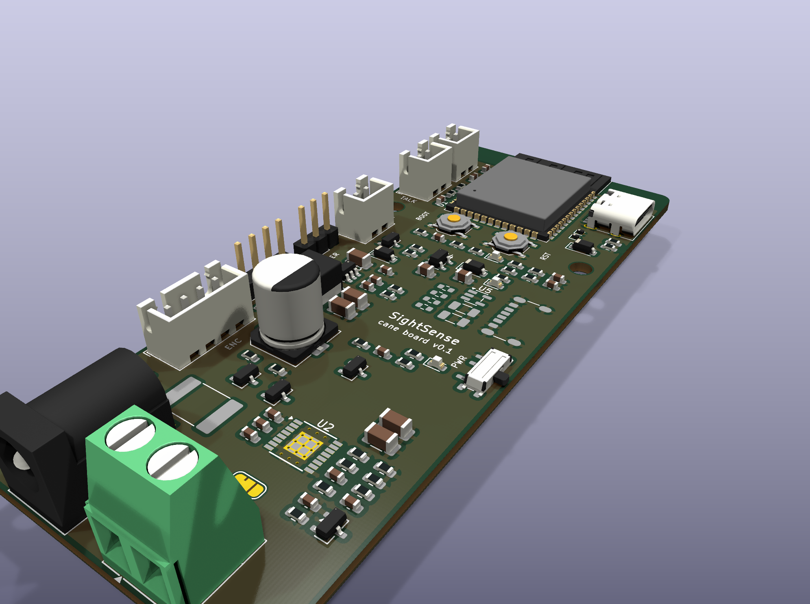
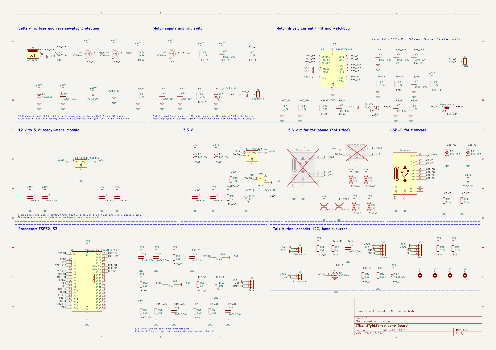
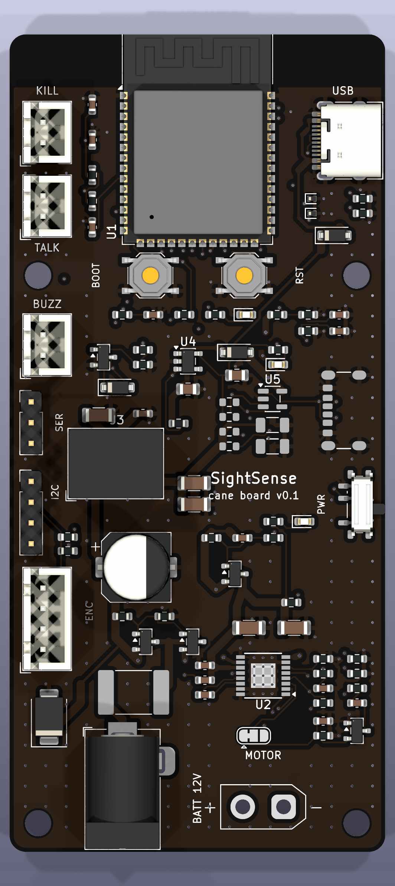
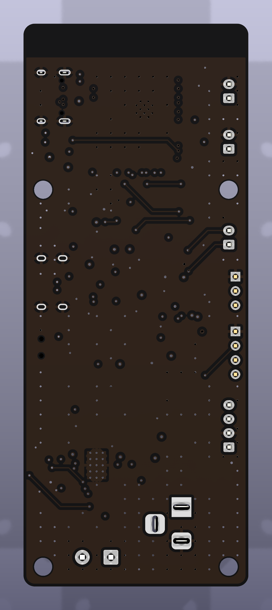

# Cane board (v0.1)

One circuit board for the cane, to replace the Raspberry Pi 5, its 12 V to 5 V converter, the IBT-2 motor driver, the green screw adapter and the jumper wires. The battery, the motor, the talk button and the kill switch stay off the board and plug into it.

A design, not a finished board. The schematic is drawn and checked, and the 46 × 100 mm board is routed on 4 layers with black solder mask: KiCad's design rules check reports 0 errors and 0 unconnected items, and the board matches the schematic. There is no firmware, and nothing has been ordered, built or tested. Drawn on October 13, 2026, after the event.

The GX10 still does all the thinking. The board does the Pi's job: it holds the link to the GX10, turns `LEFT`, `CENTER`, `RIGHT`, `STOP` and `FREE` into motor power, reads the talk button and reports its health. The messages in [`../../contracts/MESSAGES.md`](../../contracts/MESSAGES.md) do not change.

## What is on it

| Block | Main part | What it does |
| --- | --- | --- |
| Battery in | Barrel jack, resettable fuse that holds 4 A, two AO3401A | Takes the pack's barrel plug. Stays off if the plug is wired the other way round |
| Motor supply | AO3401A | Feeds the motor driver only while the kill-switch loop is closed |
| Motor driver | DRV8876 | Replaces the IBT-2. 3.5 A peak, with a current limit set by one resistor and a current reading for the processor |
| 12 V to 5 V | YLPTEC K7805-1000R3 | A sealed ready-made converter module, soldered in. 1 A, 8 to 36 V in. Chosen over a converter built from parts because its layout is done inside the module |
| 3.3 V | AP2112K-3.3 | Supply for the processor, from the 5 V rail or from the firmware socket. The power switch turns this regulator off |
| Processor | ESP32-S3-WROOM-1-N4 | Replaces the Raspberry Pi. Wi-Fi, two cores, USB built in, 4 MB of flash. No SD card, no operating system |
| Phone socket | TPS2069C, USB-C | Not fitted. Pads only. The 1 A module is too small to feed it; fitting it later needs a bigger converter |
| Firmware socket | USB-C | Loads firmware straight into the processor. Also runs the processor on a desk with no battery |
| Spare | Headers | Wheel encoder (RPM is unmeasured today), I2C, a small buzzer motor for the handle, serial |

## The board

46 × 100 mm, four layers, black solder mask, every part on the top side. Tracks on all four layers with ground poured round them and tied together by about 260 vias. The battery, motor-supply and motor tracks are drawn by hand in `make_route.py`, 0.6 to 1.0 mm wide on the outer layers, and the Freerouting autorouter routes everything else around them. The top edge points up the cane.

- **Top:** the processor, with its aerial along the top edge and nothing beside it. Kill switch, talk button and buzzer plugs on the left, where the wires from the handle arrive. Firmware socket on the right edge.
- **Middle:** 3.3 V, the 12 V to 5 V module, the power switch on the right edge, and the unfitted phone socket's pads.
- **Bottom:** battery jack and motor XT30 socket on the bottom edge, with the fuse, the two protection FETs and the motor driver just above them. The two motor tracks run straight down the underside from the driver to the XT30. Encoder plug on the left.
- Four M3 holes: two just below the processor and two at the bottom corners.

In the pictures four parts are stand-ins of the same kind and size, because KiCad ships no 3D model for the ones chosen: the firmware socket, the two push buttons and the slide switch. The fuse and the XT30 have no model and show as bare pads. The bare pads on the right are the phone socket.

### Checks on the routed board, October 14

- KiCad's design rules check: 0 errors, 0 unconnected items. The board matches the schematic (the only differences are unused pins and part descriptions).
- No copper under the processor's aerial on any of the four layers.
- Battery, motor and 5 V tracks run only on the outer layers.
- Narrowest copper on each motor-current path, pad to pad, checked by script: battery jack to fuse 1.0 mm; fuse to the protection FETs 0.6 mm; FETs to the kill-switch FET 0.8 to 1.0 mm; kill-switch FET to the driver 0.6 to 1.0 mm, then 0.4 mm for the last 1.4 mm into the pin; driver to the XT30 1.0 mm, with 0.4 mm for about 1 mm at each pin. The driver's pins are 0.3 mm wide, so the copper can not be wider there.
- By the IPC-2221 rule of thumb, a 0.4 mm outer track holding 2.2 A all the time would warm by about 35 °C; at the 0.4 to 0.6 A the motor usually takes, about 2 °C. These runs are short and next to large copper, so the real figure should be lower. Estimates, not measurements.
- Ordering files: `export/fab/` holds the Gerbers and drill files zipped for upload, JLCPCB's placement file and the BOM. Made by `make_fab.py`.

## Three ways the motor is switched off

None of these depends on the firmware being right.

1. **Kill switch.** A switch on connector J3 holds the motor supply on. Open the switch, unplug it or break a wire, and the motor supply is off, by my sums within about 2 ms. The processor cannot override it. The switch carries about 0.5 mA, so it can be small and its wires thin.
2. **Watchdog.** The driver is awake only while the processor keeps toggling one pin. If the firmware hangs or the processor resets, the driver sleeps, by my sums in about 70 ms. Solder jumper JP1 bypasses this if it misbehaves.
3. **Current limit.** R5 sets the most current the motor can ever get: 3.3 V ÷ R5 ÷ 0.001. With 1.5 kΩ that is 2.2 A, set above the 1.0 to 1.7 A stall currents in seller tables so the motor pushes as hard as it did on the IBT-2. The IBT-2 has no such limit. Lower it once the stall current is measured.

The firmware still has to keep the rules in `AGENTS.md`: off when a command's time-to-live runs out, off after 0.4 s of silence, and no motor power taken from the network.

The kill switch does not protect against its two wires shorting together. That reads as "switch closed".

**Brake or coast.** With PMODE on ground the driver runs in PH/EN mode. When the firmware turns the motor off, the driver brakes it (both low-side switches on); when the driver sleeps, through the watchdog or a hang, the motor coasts. The IBT-2 on the Pi coasted, because the Pi switched its enables off. The motor's worm gear holds the wheel either way, so the two differ only in the last few milliseconds of spin-down, and a brake ends each pulse sooner. Decided on October 14 to keep it. Firmware that wants a coast for `FREE` stops toggling the heartbeat, and the driver sleeps within about 70 ms.

## Will it run for three hours?

By these sums, yes, with a lot to spare. The phone is not powered from the board: the decision on October 13 was to leave the phone socket's parts off.

Every figure here is an estimate. Nothing was measured.

| What | Power from the battery | How I got it |
| --- | --- | --- |
| Processor, lights, standby | About 0.8 W | 120 mA at 3.3 V assumed with Wi-Fi held open. Espressif gives 95 mA receiving and 355 mA peaks sending, but no average |
| Motor, typical | About 1.3 W | Assumes the wheel drives 30% of the time at 0.4 A |
| Motor, driving all the time | About 6.6 W | 0.6 A, the highest rated current in the seller tables |
| Phone socket at full rate, if it is ever fitted | About 8.5 W | 7.5 W at the socket, plus converter loss |

The pack is labelled 12 V 3 Ah, about 32 Wh. I counted 26 Wh as usable. Its capacity has not been checked under load.

| Case | Power | Runs for |
| --- | --- | --- |
| Typical | 2.1 W | About 12 hours |
| Wheel driving all the time | 7.4 W | About 3.5 hours |
| If the socket is fitted: typical, and the phone taking 4.5 W | 7.2 W | About 3.5 hours |
| If the socket is fitted: typical, and the phone taking the full 7.5 W | 10.6 W | About 2.5 hours |

- The Raspberry Pi 5 idles at about 3 W with Wi-Fi on, so the processor's share drops to roughly a quarter.
- The phone runs on its own battery, about 13.6 to 13.9 Wh, and is likely to run out before the cane does. How much the app draws is not measured.
- The socket can no longer be fitted as it is: the 1 A module is too small for it, so a bigger converter would be needed first. If that is done, a 5 Ah pack of the same kind would cover every row above. Whether an iPhone takes 1.5 A from it is not confirmed; the socket advertises 1.5 A the standard way, with 22 kΩ on each CC pin.

## Currents against the parts' ratings

| Path | Most it can carry by design | Part's rating |
| --- | --- | --- |
| Battery jack, fuse, reverse-plug FETs | About 2.5 A: motor at its 2.2 A limit and the processor's peaks, on a 9 V pack | Jack 5 A, fuse holds 4 A, two FETs of 4 A each side by side |
| Kill-switch FET | 2.2 A, the motor's limit. About 0.3 W of heat then, an estimated 35 °C rise. R2 and R3 hold its gate at 0.43 of the battery: 3.9 V from a flat 9 V pack, 10.6 V at the protection diode's clamp | 4 A |
| Motor driver | 2.2 A, set by R5 | 3.5 A peak |
| 5 V rail | About 0.5 A, the processor's peaks | 1 A |
| 3.3 V rail | About 0.44 A: 355 mA Wi-Fi peak and an 80 mA buzzer | 0.6 A |

- The motor's stall current is 1.0 to 1.7 A in seller tables for JGY-370 motors. None of those tables is for the team's motor. Measure it, then choose R5.
- A stalled motor at 1.7 A makes the driver turn about 2 W into heat (0.7 Ω, two switches in series); at the 2.2 A limit, about 3.4 W. Either is too hot to last; the driver's own over-temperature cut-out switches it off, and the firmware should stop on a stall. At 0.4 to 0.6 A it is 0.1 to 0.25 W.
- On the Pi the IBT-2 ran the motor at 70 to 100% power with no limit at all, so the 2.2 A limit should not take away push the motor had.

## Processor pins

| ESP32 pin | Net | Job |
| --- | --- | --- |
| IO1 | `I_ADC` | Motor current, 1.5 V per amp with R5 at 1.5 kΩ. Reads up to about 2 A |
| IO2 | `VBAT_ADC` | Battery voltage ÷ 5.55 |
| IO4 | `VM_ADC` | Motor supply ÷ 5.55. Tells the firmware whether the kill switch is closed |
| IO5 | `MOT_EN` | Motor power (PWM) |
| IO6 | `MOT_PH` | Motor direction |
| IO7 | `HBEAT` | Watchdog: must keep toggling |
| IO8, IO9 | `SDA`, `SCL` | I2C header |
| IO10 | `HAPTIC` | Buzzer motor |
| IO11 | `PH_EN` | Phone socket on (high) or off. Spare while the socket is not fitted |
| IO12 | `PH_FLT` | Phone socket overloaded (low). Spare while the socket is not fitted |
| IO13, IO14 | `ENC_A`, `ENC_B` | Encoder header |
| IO15 | `DRV_FLT` | Motor driver fault (low) |
| IO16 | `TALK` | Talk button (low when pressed) |
| IO21 | `LED_ST` | Status light |
| IO19, IO20 | `USB_DN`, `USB_DP` | Firmware socket |

The current, battery and motor-supply readings use ADC1, which works with Wi-Fi on. The motor pins only glitch low at power-up, by Espressif's table, and the driver is asleep then anyway.

## Connectors

| Ref | For | Type |
| --- | --- | --- |
| J1 | Battery | Barrel jack for a 5.5 mm plug, 2.0 mm pin. Measure the pack's plug before ordering: a 2.5 mm plug will be loose, and the same jack comes with a 2.5 mm pin |
| J2 | Motor | XT30 socket, upright. Solder the motor wires to a matching XT30 plug; nothing is soldered to the board. Which wire goes to which pin only sets the wheel's direction, which the firmware can swap, as `--swap` does on the Pi |
| J3 | Kill switch | JST XH, 2 way. Fit a jumper if there is no switch |
| J4 | Talk button | JST XH, 2 way. The 10 kΩ pull-up `wiring.md` suggests for a long wire is on the board |
| J5 | Wheel encoder | JST XH, 4 way: 3.3 V, ground, A, B |
| J6 | I2C | Pin header, 4 way |
| J7 | Buzzer motor | JST XH, 2 way, 3.3 V |
| J8 | Serial | Pin header, 3 way |
| J10 | Phone power | USB-C, power only. Not fitted |
| J11 | Firmware | USB-C |

## Cost

[`BOM.md`](BOM.md) has every line with its order code, price and JLCPCB class, read from JLCPCB's parts library on October 13, 2026.

- Parts for one board: $10.48. The processor module is $4.13 of that.
- Five boards made and assembled by JLCPCB, 4 layers, black: $107.31 before shipping, duty and tax; about $172 delivered with the 35% tariff, so about $34 a board. See [`COST.md`](COST.md).
- The BOM lists the changes that cut the cost and what each one changed in the design.
- Bench-test parts to buy first: a DRV8876 breakout at $8.15 and an ESP32-S3 dev board at about $15 to $20.
- Not priced: the kill switch and the plug leads.

What the board replaces is not priced in this repository. My guess for a Raspberry Pi 5 with cooler, case and card, the converter and the IBT-2 is $100 to $120.

## Files

| File | What it is |
| --- | --- |
| `make_board.py` | Lists every part and the net on every pin, draws the schematic from that, and checks it. Standard-library Python; needs KiCad 10 |
| `cane-board.kicad_sch`, `cane-board.kicad_pro` | The KiCad 10 project. Open it in KiCad to look or to carry on by hand |
| `cane-board.kicad_sym`, `sym-lib-table` | The DRV8876 symbol, which KiCad does not ship |
| `make_pcb.py` | Places every part on the board from a table of positions, joins the pads to their nets, runs KiCad's design rules check and renders the 3D pictures. Run it with the Python inside KiCad |
| `make_route.py` | Lays the hand-drawn power tracks, runs the Freerouting autorouter for the rest, widens what it can, pours and stitches ground, makes the board black and runs the design rules check. Needs Java and the Freerouting jar in `FREEROUTING_JAR` |
| `make_fab.py` | Writes the ordering files in `export/fab/` |
| `cane-board.kicad_pcb` | The routed board |
| `export/cane-board.pdf` | The schematic to read or print |
| [`BOM.md`](BOM.md) | What to buy, with order codes and prices, and what the board lets you drop |
| `export/parts.csv` | The board's parts grouped into lines to buy |
| `export/bom-jlcpcb.csv` | The fitted parts in the columns JLCPCB's assembly order form reads |
| `previews/cane-board.png` | Picture of the PDF, made separately |
| `previews/board-*.png` | 3D pictures of the board, rendered by KiCad |

`python3 make_board.py` rewrites the schematic, so edits made in KiCad are lost. Either change the script, or stop running it once the schematic is being drawn by hand.

Schematic checks on the last run, October 14: 256 pins on 56 nets all on the net the script lists, as read back from KiCad's own netlist; every pin has a matching pad on its footprint; KiCad's electrical rules check reports 0 errors and 0 warnings. These show the drawing matches the list. They do not show the circuit works.

## Not done

- **The network.** A Raspberry Pi can run Tailscale. An ESP32 cannot. The board has to be on the same Wi-Fi network as the GX10, or its commands have to come another way, such as through the phone. Not decided.
- **Firmware.** `pi/cane.py` and `pi/wheel_drive.py` have to be rewritten for the ESP32, with the same limits and the same tests.
- **A new electronics mount** for the 46 × 100 mm board.
- **Measurements this design leans on:** the motor's stall and running current, the battery's real capacity, the phone's draw, and the size and polarity of the pack's plug.
- **Try it on bought boards first.** An ESP32-S3 dev board and a DRV8876 breakout would prove the firmware and the motor numbers before any board is ordered.
- Small things known to be rough: the watchdog, the kill-switch timing and the gate resistors that replaced the zeners are worked out on paper only; and if the phone socket is ever fitted, it has 5 V on it whenever it is switched on, not only when a phone is attached.

## Where the facts come from

Looked up on October 13 and 14, 2026.

- DRV8876 pins, modes, current-limit formula, capacitors and land pattern: TI datasheet SLVSDS7B.
- K7805-1000R3 pins (1 in, 2 ground, 3 out), 8 to 36 V in, 1 A out: YLPTEC datasheet, read October 14.
- XT30UPB-F: AMASS drawing via KiCad's footprint and the LCSC listing C108769.
- TPS2069C enable polarity and limits: TI datasheet SLVSAU6I. AP2112K: Diodes DS39724.
- AO3401A (30 V, 4 A, gate limit ±12 V, under 85 mΩ with 2.5 V on the gate, 125 °C/W): Alpha & Omega datasheet rev. 3.1.
- Every part's price, stock and class: JLCPCB's parts library, read on October 13, 2026.
- ESP32-S3-WROOM-1 pins, boot pins, power-up glitches, ADC and currents: Espressif module datasheet v1.8 and chip datasheet v2.2.
- USB-C pull-up values: Microchip AN1953, table 6, quoting the USB Type-C specification.
- Motor currents: an OzRobotics JGY-370B table and a Seeed/Aslong sheet. No table for a 120 rpm JGY-370 could be fetched.
- Raspberry Pi 5 idle power: CNX Software's review (3.0 W headless with Wi-Fi) and Jeff Geerling's measurements (2.4 to 3.3 W).
- iPhone 16 Pro battery: 3,582 mAh from a regulatory filing reported by 9to5Mac. Apple does not publish it.
- Barrel jack (5 A, 2.0 mm pin, hole pattern): XKB's drawing for the DC-005-5A-2.0.
- Symbols and footprints other than the DRV8876: KiCad 10's own libraries.
