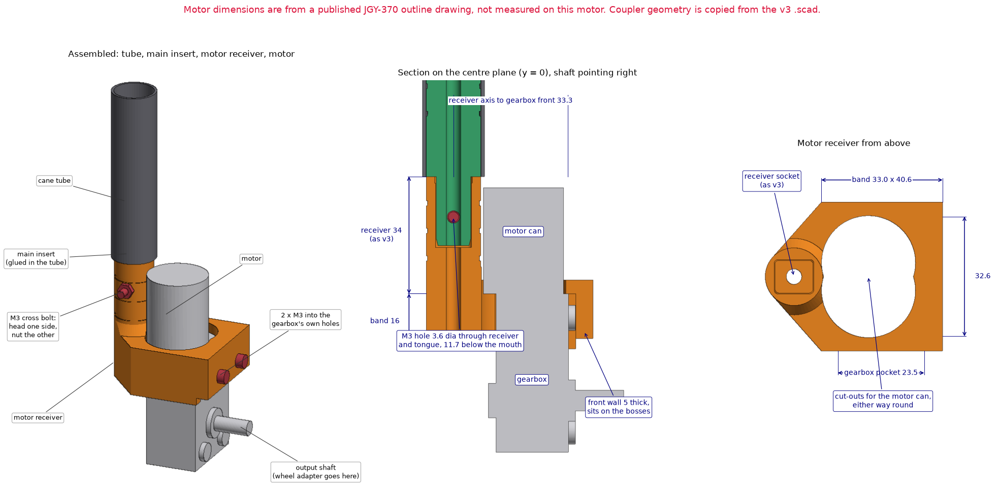

# Cane coupler (keyed, shock-cord, v3)

A two-piece insert that joins two sections of carbon-fibre tube so the cane can fold, like a tent pole. One piece is glued into each tube. A keyed tongue stops the sections twisting against each other, and a hole through the middle carries the shock cord that pulls them together.

The files use the project's earlier working name, PathSense.

## Files

| File | What it is |
| --- | --- |
| `PathSense_Keyed_ShockCord_Main_v3.stl` | Male insert: barrel plus keyed tongue. Glue into tube A. |
| `PathSense_Keyed_ShockCord_Receiver_v3.stl` | Female insert with the matching socket. Glue into tube B. |
| `PathSense_Keyed_ShockCord_Coupler_v3.scad` | OpenSCAD source for both parts. Change `MODE` to export each one. |

## Dimensions (from the `.scad` source)

| Feature | Value |
| --- | --- |
| Tube it fits | 18 mm outside, 16 mm inside, carbon fibre |
| Insert diameter | 15.70 mm (clearance for epoxy) |
| Main insert | 42 mm barrel + 20 mm tongue = 62 mm long |
| Tongue | 10.0 × 8.5 mm, rounded, with a 2 mm tapered tip |
| Receiver insert | 34 mm long |
| Socket | 10.35 × 8.85 mm, 20.5 mm deep, with a wider 2 mm lead-in |
| Tongue-to-socket clearance | 0.35 mm total |
| Shock-cord hole | 4.2 mm, for 1/8 in (3.2 mm) cord |
| Glue grooves | 3 per barrel, 0.35 mm deep, 1.4 mm wide, 8 mm apart |

The STL files were checked against these numbers: the main part measures 15.7 × 15.7 × 62.0 mm and the receiver 15.7 × 15.7 × 34.0 mm.

## Exporting from OpenSCAD

Set `MODE` near the top of the `.scad` file, then render and export:

| `MODE` | Shows |
| --- | --- |
| `"main"` | The male insert only |
| `"receiver"` | The female insert only |
| `"exploded"` | Both parts, spaced apart |
| `"assembled"` | Both parts engaged |
| `"demo"` | Both parts in tube sections with the cord (default) |

## Printing notes

These are suggestions, not tested settings.

- **Material:** PETG-CF. TPU is too soft for this part.
- **Nozzle:** hardened steel, because carbon-fibre filament wears out brass.
- **Walls and infill:** 4 walls or more. The tongue is small enough that it will print nearly solid.
- **Orientation:** the tongue takes the bending load when the cane is leaned on. Printed standing upright, the layer lines run across the tongue, which is its weakest direction. Printing the main insert lying on its side makes the tongue stronger, at the cost of a less round barrel and some support material.
- **Thin wall:** the cord hole leaves about 2.15 mm of wall on the tongue's short side. This is the part most likely to crack.
- **Fit check before gluing:** the insert should slide into the tube with slight resistance, and the tongue should enter the socket without forcing. Adjust `insert_od`, `socket_w` and `socket_h` for your printer and reprint if needed.

## Assembly

1. Lightly sand the inside of each tube end and wipe it clean.
2. Test-fit both inserts dry, with the cord threaded through.
3. Apply epoxy to the barrel and its grooves, push the insert in, and wipe off the excess. Keep epoxy out of the socket and the cord hole.
4. Let it cure fully before loading the joint.

## v4: M3 cross bolt and motor receiver

Two new parts for the tip of the cane. The v3 files above are unchanged and kept.

Experimental prototype. Neither v4 part has been printed, fitted or load tested.

| File | What it is |
| --- | --- |
| `PathSense_Keyed_ShockCord_Main_v4.stl` | The v3 male insert with one M3 hole across its tongue. |
| `PathSense_Keyed_ShockCord_MotorReceiver_v4.stl` | The v3 receiver with the same M3 hole, standing on a band that holds the JGY-370 gearmotor beside it. |
| `*_v4.step` | The same parts for CAD. |
| `coupler_motor_mount.py` | build123d source for both. Running it exports the parts and runs the geometric checks; `--preview` also renders the drawing. It imports helpers from `../handle-phone-mount/`. |

### Same coupler geometry as v3

The socket, tongue, grooves and cord hole are rebuilt from the values in the `.scad` file. The rebuilt v3 parts were compared with the v3 STL files: the sizes are identical and the volumes agree to within 0.06% (receiver 4438.0 against 4435.5 mm³, main 8869.4 against 8867.2 mm³).

### The cross bolt

| Feature | Value |
| --- | --- |
| Hole | 3.6 mm, for M3, through the receiver and the tongue. It was 3.2 mm until October 11: on the wheel adapter's first test print, M3 screws would not pass 3.2 mm holes |
| Position | 11.7 mm below the receiver's mouth and the same distance up the tongue from its root, between two glue grooves |
| Direction | Through the tongue's 8.5 mm side, leaving 3.2 mm of tongue each side of the hole |
| Seats | 6.6 mm flat for the screw head on one side, 5.8 mm hex pocket for the nut on the other, each 1 mm deep |
| Screw | M3 × 20, with an M3 nut (an M3 × 16 only just reaches through the nut) |

The holes line up when the tongue is fully seated. The screw crosses the cord hole, so the shock cord can no longer pass through this joint.

### The motor mount

The receiver stands behind the motor can, parallel to it, with its closed end level with the top of the gearbox and the output shaft pointing away from it.

| Feature | Value |
| --- | --- |
| Receiver axis | 33.3 mm behind the gearbox's front face, 0.6 mm off the motor can |
| Band | Wraps the top 16 mm of the gearbox; 33.0 × 40.6 mm outside |
| Gearbox pocket | 23.5 × 32.6 mm (0.3 mm clearance per side; the front wall rests on the two mounting bosses) |
| Front wall | 5 mm thick, with two 3.4 mm holes 18 mm apart, 7 mm below the gearbox's top end |
| Shelf | 4 mm thick; the gearbox's top end stops against it |
| Overall | 48.3 × 40.6 × 50.0 mm |

- The motor slides up into the band from below until the gearbox stops against the shelf. Two M3 screws then go through the front wall into the gearbox's own threaded holes.
- The motor can sits off-centre on the gearbox. The mount has cut-outs for the can on both sides, so it fits whichever way the can is offset.
- The wheel adapter's collar and clamp screw pass 2 mm below the band.
- [`../motor-mount-2/`](../motor-mount-2/) is a sturdier version of this receiver. It takes the same v4 main insert and the same cross bolt.

**Motor dimensions come from a published JGY-370 outline drawing, not from measuring this motor:** gearbox 46 × 32 × 21 mm (25.2 mm over the bosses), four M3 holes on 18 × 33 mm, bosses 7.4 mm diameter and 2 mm tall, thread 12 mm deep, shaft 31 mm below the gearbox's top end, motor can 24.4 × 30.8 mm. Source: <https://innovatorsguru.com/jgy-370-dc-motor/>.

### Hardware

| Qty | Item | Where |
| --- | --- | --- |
| 1 | M3 × 20 screw + M3 nut | Cross bolt through receiver and tongue |
| 2 | M3 × 12 to 16 screw | Front wall into the gearbox. A longer screw bottoms out in the 12 mm deep thread |

### Assembly

1. Glue the main insert into the tube as for v3. Its barrel has to end level with the tube's end, to within about half a millimetre, or the cross-bolt holes will not line up. The sure way is to let the glue set with the receiver pushed on and the bolt through; keep glue off the tongue.
2. Slide the motor up into the band and fit the two screws through the front wall.
3. Fit the wheel adapter and wheel on the shaft. Do this after step 2, because the wheel covers the two motor screws.
4. Push the receiver onto the tongue until it seats, then fit the cross bolt and nut.

### Printing notes

These are suggestions, not tested settings.

- **Orientation:** both parts are exported standing upright, which needs no supports. Layer lines then run across the receiver barrel and the tongue, their weakest direction, as noted for v3 above.
- **Weakest point:** the tongue is still the thinnest section between the tube and the wheel, and the cross hole removes some of it.
- **Main insert:** it stands 62 mm tall on a 16 mm base. Give it a brim so that a moving bed does not shake it loose, and sand the first layer's edge if it will not enter the tube.
- **Time:** a slicer's estimate for the main insert on a Creality Ender-3 S1 (0.4 mm nozzle, generic PETG, 0.2 mm layers, printed solid) is 1 h 37 min and 11 g. Not a timed print.

### Still to check

1. The gearbox thickness and the position of its two upper mounting holes, against the motor.
2. That the motor can clears the receiver once the motor is seated.
3. That the cross bolt's holes line up with the tongue fully seated.
