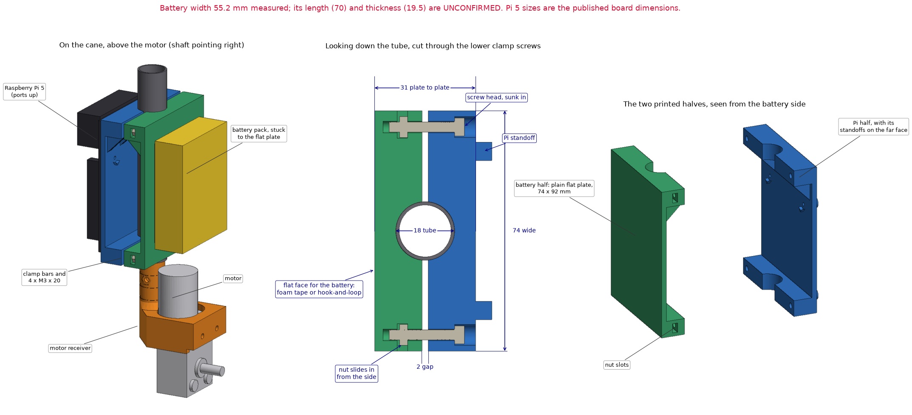
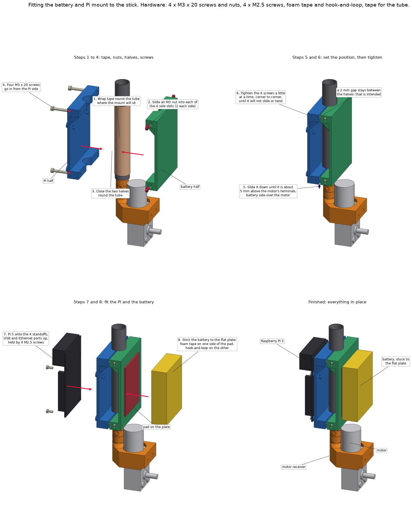

# Electronics mount (v2)

A two-piece clamp for the bottom of the cane that carries the Raspberry Pi 5 on one side and the 12 V battery pack on the other, just above the motor.

Experimental prototype. Nothing here has been printed, fitted or load tested.

## How it works

The two halves close around the 18 mm tube like a clamshell and are pulled together by four M3 × 20 screws. Nothing slides over the end of the tube, so the mount goes on with the handle and the wheel in place, and it can be slid along the tube and turned to any angle before tightening.

- **Pi half:** a plate with four standoffs on the Raspberry Pi 5's hole pattern. The Pi sits with its USB and Ethernet ports up and its microSD slot at the bottom.
- **Battery half:** a plain flat plate, 74 × 92 mm, with nothing standing up from it. The pack is stuck on with foam tape and hook-and-loop. (v1 had a cradle with walls, a shelf and strap slots; the team asked for a flat plate instead.)

## Files

| File | What it is |
| --- | --- |
| `electronics_mount.py` | build123d source. Running it exports the parts and runs the geometric checks; `--preview` also renders the drawing. It imports the motor receiver from `../cane-coupler/` and helpers from `../handle-phone-mount/`. |
| `electronics_mount_steps.py` | Renders the picture of the mounting steps. |
| `export/electronics_mount_pi_half.stl` | Pi half, standing upright as it prints |
| `export/electronics_mount_battery_half.stl` | Battery half, lying on its flat face as it prints |
| `export/*.step` | The same parts for CAD |

## Where the sizes come from

| Size | Value | Source |
| --- | --- | --- |
| Tube | 18 mm outside diameter | As the rest of the cane |
| Raspberry Pi 5 board | 85 × 56 mm, holes on 58 × 49 mm, 3.5 mm from the edges, 2.7 mm diameter | Published board dimensions |
| Battery width | 55.2 mm | Measured by the team |
| Battery length and thickness | About 70 and 19.5 mm | Seller listings for 18650 3S1P packs; not measured. The flat plate does not depend on them |

## Dimensions (from the source)

| Feature | Value |
| --- | --- |
| Each plate | 74 × 92 mm, 3 mm thick |
| Plate to plate | 31 mm over the outer faces |
| Saddles | 18.1 mm diameter, so they grip the tube before the halves meet |
| Gap between the halves when clamped | 2 mm |
| Clamp bars | Two per half, 10 mm tall, at the top and the bottom |
| Clamp screws | Four, 64 mm apart across the mount, 3.6 mm holes for M3 |
| Screw heads | Sunk into 6.5 mm counterbores, 0.75 mm outside the Pi's edge |
| Nut slots | 5.8 × 3.2 mm, open at the sides of the battery half |
| Pi standoffs | 6.5 mm diameter, 5 mm tall, 2.2 mm pilot holes |
| Pi half | 19.5 × 74 × 92 mm, 34.5 cm³ |
| Battery half | 14.5 × 74 × 92 mm, 35.4 cm³ |

On the cane the mount sits 40 mm above the top of the gearbox, 5 mm over the motor's terminals, with the battery over the motor and the Pi at the back. With the Pi over the motor there is no room to get the microSD card in or out. In the model it clears the motor by 9.2 mm and the motor receiver by 6.1 mm.

## Hardware

| Qty | Item | Where |
| --- | --- | --- |
| 4 | M3 × 20 socket-head screw + M3 nut | Clamp |
| 4 | M2.5 × 6 screw | Raspberry Pi 5 to the standoffs. The Pi's holes are too small for M3; each screw cuts its own thread in a 2.2 mm pilot hole |
| — | Foam tape and hook-and-loop | Battery to the flat plate |
| — | Tape | One or two turns round the tube under the clamp, for grip |

## Fitting it

1. Wrap one or two turns of tape round the tube where the mount will sit.
2. Slide an M3 nut into each of the four side slots on the battery half.
3. Close the two halves round the tube.
4. Push the four M3 × 20 screws in from the Pi half and start each in its nut.
5. Slide the mount down until it is about 5 mm above the motor's terminals, battery side over the motor.
6. Tighten the four screws a little at a time, corner to corner, until it will not slide or twist. A 2 mm gap stays between the halves. Stop at snug: the upper clamp is on bare tube with a 1 mm wall.
7. Set the Pi 5 on the standoffs, ports up, and drive in the four M2.5 screws.
8. Stick the battery to the flat plate.

The clamp screws stay reachable with the Pi fitted.

## Printing notes

These are suggestions, not tested settings.

- **Pi half:** standing upright, as exported, with no supports. The standoffs are teardrop shaped and the top bar sits on 45 degree ribs so that both print without support.
- **Battery half:** lying on its flat face, as exported, with no supports.
- **Material:** PETG-CF, as for the other rigid parts.

## Still to check

1. That the clamp holds on the carbon tube without slipping or twisting, and without crushing it.
2. That the foam tape and hook-and-loop hold the pack when the cane is tapped and shaken. A zip tie round the pack and the plate is a simple backup.
3. The Pi's fit on the standoffs.

There is no place on this mount for the motor driver board. `pi-plate/` in the hardware index is still to design for that.
