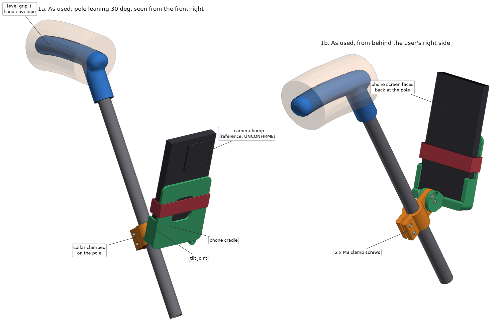

# Handle and phone mount (v1)

A handle for the top of the cane and an adjustable phone mount that clamps on the pole below it. Three printed parts: the handle, a collar for the pole, and a cradle for the phone.

Experimental prototype. Nothing here has been printed, fitted or load tested, and it is not a replacement for a white cane or a guide dog.

**The cradle is not ready to print.** It is sized for a placeholder phone (78 × 162 × 12 mm in a case). Set the `PHONE_*`, `CAM_*` and `BUTTON_KEEPOUT` values at the top of `walking_stick.py` to the iPhone 16 Pro in its case and re-export first. The handle and collar depend only on the 18 mm / 16 mm tube.

## Files

| Path | What it is |
| --- | --- |
| `walking_stick.py` | build123d source for every part. Running it exports the parts and runs the geometric checks. |
| `preview.py` | Renders the review images into `previews/`. |
| `viewer.py`, `viewer.html` | Builds, and is, a self-contained 3D viewer. Open `viewer.html` in a browser. |
| `export/stick_handle.stl` | Handle |
| `export/camera_collar.stl` | Collar that clamps on the pole and carries the tilt joint |
| `export/phone_cradle.stl` | Phone cradle (placeholder phone size) |
| `export/handle_fit_test.stl` | Short slice of the handle socket, to check the tube fit |
| `export/cradle_fit_test.stl` | Bottom slice of the cradle, to check the phone and joint fit |
| `export/*.step`, `export/assembly.step` | The same parts for CAD, and the three parts in place |

The STL files are already turned to their print orientation. File names follow the script's part names and carry no version suffix yet.

`walking_stick.py` also contains `make_motor_mount()`, an early sketch for a 37 mm gearmotor driving a wheel directly. It does not match this project's steering design and is not exported here.

To rebuild (running the script also writes `motor_mount` files into `export/`; they are left out of this folder on purpose):

```bash
pip install build123d numpy matplotlib
python walking_stick.py
python preview.py
python viewer.py
```



## Layout

- **Handle** (`stick_handle`): just a handle. The grip is turned 30 degrees
  nose-down (`GRIP_TILT_DEG`), so it is level when the pole leans back 30
  degrees. The pole joins near the front of the grip and all four fingers wrap
  the grip behind it.
- **Collar** (`camera_collar`): split clamp on the pole below the handle, two
  M3 pinch screws. Slide it up or down and turn it before tightening. A tongue
  on its front carries the tilt joint.
- **Cradle** (`phone_cradle`): pivots on the collar's tongue. The phone stands
  up from the pivot in portrait, screen facing back at the pole, rear camera
  facing forward.

`PHONE_TILT_DEG` is the angle between the camera axis and the pole's forward
normal. At 0 the phone is parallel to the pole; positive values swing its top
forward and pitch the camera down. With the pole leaning back by L degrees the
camera looks `tilt - L` degrees below the horizon. The joint locks at 0, 15,
30, 45, 60 and 75 degrees. The default is 45, which is 15 degrees below the
horizon at a 30 degree lean.

## Hardware

| Qty | Item | Where | Hole type |
|---|---|---|---|
| 2 | M3 x 20 screw | collar clamp | 3.2 mm close fit |
| 1 | M3 x 20 screw | tilt pivot | 3.2 mm close fit through cheeks and tongue |
| 1 | M3 x 20 screw | tilt index pin | 3.2 mm close fit through cheeks and tongue |
| 4 | M3 nut | one per screw above | hex pockets, 5.7 mm across flats |
| 1 | M3 x 6 to 8 screw | tube lock in the handle socket | 2.6 mm pilot: the screw cuts its own thread |
| 1 | 20 mm hook-and-loop cinch strap, about 250 mm | phone retention | sits in the plate's edge notches |
| 1 | cord or lanyard, up to 3 mm | tether | 4 mm eyelet under the back plate |

Every screw is M3. Through-holes are modelled at 3.2 mm: printed holes come out
a little small, so they end up close to 3.0 mm and a 3 mm screw is a snug
sliding fit. If a screw will not go in, turn it in or run a 3 mm drill through.
The sizes are `CLAMP_BOLT_D`, `PIVOT_BOLT_D` and `INDEX_D`.

A wrap of tape or thin rubber under the collar helps it grip the smooth carbon.

## Print orientation

The STLs in `export/` are already turned this way.

| Part | On the bed | Supports |
|---|---|---|
| `stick_handle` | on its side | under the grip and socket |
| `camera_collar` | upright, bore vertical | none |
| `phone_cradle` | back plate down | under the side lips and bottom lip only |
| `cradle_fit_test` | back plate down | under the lips only |
| `handle_fit_test` | closed end down | none |

Print `handle_fit_test` first, and `cradle_fit_test` once the phone is measured.

## Assembly

1. Press the handle onto the tube with the grip's long end towards the user,
   and lock it with the M3 screw in the socket.
2. Open the collar slightly, slide it onto the pole below the handle with the
   tongue pointing forward, and fit two M3 screws and nuts loosely.
3. Push two M3 nuts into the pockets in the cradle's -Y cheek.
4. Fit the cradle's cheeks over the collar's tongue and pass an M3 screw
   through the centre hole. Leave it loose.
5. Swing the cradle to the tilt you want and fit another M3 screw through whichever
   outer cheek hole lines up with a tongue hole, then tighten both.
6. Set the collar's height and aim, then tighten the two clamp screws.
7. Slide the phone down into the cradle from above, wrap the strap around the
   phone and back plate in the notches, and clip a tether to the eyelet.

## What has and has not been checked

Checked by `walking_stick.py`, geometrically, on the placeholder phone:

- every part is a single valid solid
- at each of the six tilt steps: no collision between cradle or phone and the
  collar, tube, handle or hand envelope; the index pin lines up with a hole; a
  straight tool reaches every screw head and nut
- the phone lifts straight out of the cradle
- the camera view volume (35 degree half angle from the bump) misses every part
- side walls, strap and back plate stay out of the button and camera bands as
  set in the parameters

Not checked, and needing a physical prototype:

- [ ] Tube fit of the handle and collar, using `handle_fit_test`.
- [ ] Grip comfort and angle with the pole leaning as you actually hold it.
- [ ] Collar does not slip down or twist on the carbon tube.
- [ ] Phone fit, using `cradle_fit_test` and the real phone in its case.
- [ ] Retention: phone stays put when the stick is shaken and tapped.
- [ ] Camera view: frames show no part of the mount, pole or hand at the tilt
      and lens you will use. The camera sees forward and to the sides; the pole
      and the user are behind it.
- [ ] Buttons, port, microphones and speaker are reachable and uncovered.
- [ ] Joint locking: the tilt does not creep or rattle after walking.
- [ ] Strength: no cracking at the collar ears, the tongue root or the cheek
      roots after repeated use. No load rating exists.
