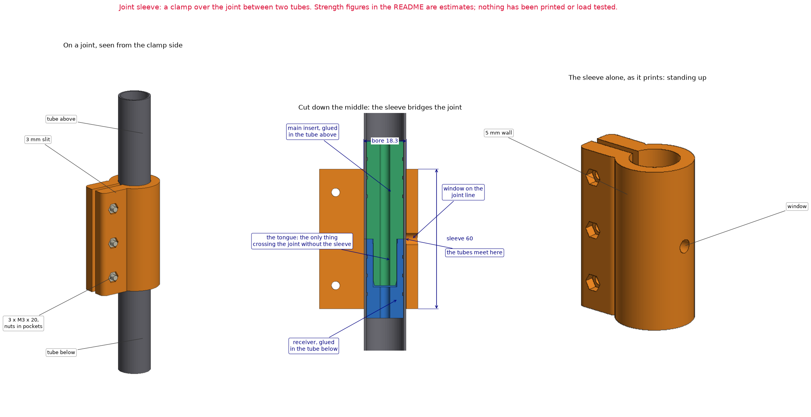

# Joint sleeve

A clamp that goes over the joint between two cane tubes, so that the sleeve, not the coupler's printed tongue, carries the bending there. One per joint: three for a cane of four tubes.

Experimental prototype. Nothing here has been printed, fitted or load tested. The strength figures below are estimates from the model and from typical material values, not measurements.

## Why it is needed

At a joint the two tubes only butt end to end. The one thing that crosses the joint is the tongue of the coupler in [`../cane-coupler/`](../cane-coupler/): 10 × 8.5 mm of printed plastic with a 4.2 mm hole down its middle.

| | Estimate | From |
| --- | --- | --- |
| Bending on the top joint when a four-tube cane is carried level by its handle | 8 to 12 N·m | The cane's own weight: about 0.6 to 0.9 kg sits within 250 mm of the wheel. The phone, battery, motor and wheel are weights from typical listings, not weighed |
| The same at the 30 degree lean the handle is drawn for, wheel off the ground | 4 to 6 N·m | Half of the above |
| What the tongue takes, insert printed standing up | 2 to 4 N·m | Section modulus 117 mm³, 15 to 35 MPa across the layers |
| What the tongue takes, insert printed lying down | 5 to 7 N·m | The same section, 40 to 60 MPa along the layers |
| What this sleeve's ring takes, printed standing up | 28 to 64 N·m | Section modulus 1,836 mm³, 15 to 35 MPa across the layers |

So the upper joints are likely to break when the cane is lifted, before any knock. The sleeve's section carries about 16 times the bending of the tongue's for the same stress.

The coupler is still needed. Its key stops the tubes twisting against each other and lines them up.

## How it works

It is the camera collar's clamp from [`../handle-phone-mount/`](../handle-phone-mount/), made longer and without the tilt joint: a ring with a slit and two ears, pulled closed by three M3 screws.

- It covers 30 mm of each tube. The glued-in inserts fill the tubes for 42 mm above the joint and 34 mm below, so the clamp squeezes a wall that is backed, not a hollow one.
- A 5 mm window opposite the clamp sits on the joint line, to see or feel that the sleeve is centred.

## Files

| File | What it is |
| --- | --- |
| `joint_sleeve.py` | build123d source. Running it exports the part and runs the geometric checks; `--preview` also renders the drawing. It imports the coupler from `../cane-coupler/` and helpers from `../handle-phone-mount/`. |
| `export/joint_sleeve.stl` | The part, standing upright as it prints |
| `export/joint_sleeve.step` | The same part for CAD |

## Dimensions (from the source)

| Feature | Value |
| --- | --- |
| Overall | 42.3 × 28.3 × 60.0 mm, 33.7 cm³ |
| Bore | 18.3 mm, for the 18 mm tube (0.15 mm per side before clamping) |
| Wall | 5 mm, so 28.3 mm outside |
| Slit | 3 mm |
| Ears | 18 mm across the pair, standing 14 mm out from the ring |
| Screws | Three, 20 mm apart, in 3.6 mm holes; 5.8 mm hex pockets 3.5 mm deep for the nuts |
| Window | 5 mm, through the wall opposite the clamp, at mid-length |

## Hardware, for each sleeve

| Qty | Item |
| --- | --- |
| 3 | M3 × 20 socket-head screw + M3 nut. Each clamps 14.5 mm, which leaves 5.5 mm of thread for the nut |

## Fitting it

1. Slide the sleeve onto one of the two tubes before joining them. It does not open far enough to go on from the side.
2. Join the tubes, then slide the sleeve along until the seam between them shows in the window.
3. Tighten the three screws a little at a time until the sleeve will not slide or turn. Stop at snug.

To take the cane apart, loosen the screws and slide the sleeve along one tube. A wrap of tape under the sleeve helps it grip the smooth carbon, as for the camera collar.

On a cane of four 400 mm tubes the joints are 400, 800 and 1,200 mm below the top. The phone and its cradle reach down to about 276 mm, so the top sleeve (370 to 430 mm) clears them.

## Printing notes

These are suggestions, not tested settings.

- **Orientation:** standing upright, as exported, with the bore vertical. No supports. The screw holes and nut pockets lie on their side.
- **Layer direction:** upright puts the layers across the pole, which is the weakest direction for bending. The 5 mm wall allows for that; the table above uses the across-the-layers strength.
- **Walls and infill:** 4 walls or more, 40% infill or more.
- **Time:** a slicer's estimate for a Creality Ender-3 S1 (0.4 mm nozzle, generic PETG, 0.2 mm layers, 4 walls, 40% infill) is 3 h 53 min and 33 g for one sleeve, so about 11 h 40 min for three. Not a timed print.
- **If there is not time to print three:** every joint left out is a sleeve not needed. A cane of two tubes has one joint.

## Still to check

1. That the bore slides onto the tube, and that the clamp grips without marking or cracking it.
2. That it holds: with the cane assembled, lift it level by the handle, slowly, over something soft.
3. The weights behind the load estimate, with a scale.
