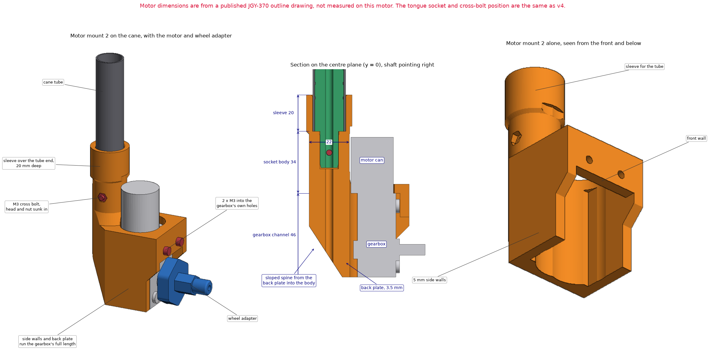

# Motor mount 2

A sturdier version of the v4 motor receiver in [`../cane-coupler/`](../cane-coupler/). It does the same job on the same idea: it takes the keyed tongue of the v4 main insert and one M3 cross bolt at the top, and holds the 12 V gearmotor at the bottom.

Experimental prototype. Nothing here has been printed, fitted or load tested. "Sturdier" describes the design (more plastic, and a sleeve over the tube); it has not been measured.

## What changed from the v4 receiver

| | v4 motor receiver | Motor mount 2 |
| --- | --- | --- |
| Join to the tube | The tongue and the cross bolt only | The same, plus a sleeve that goes 20 mm over the end of the tube, so bending passes from the mount into the tube and not only through the tongue |
| Receiver body | 15.7 mm across, with glue grooves | 22 mm across, no grooves |
| Plastic round the tongue socket, at its thinnest | 2.7 mm | 5.8 mm |
| Hold on the gearbox | A band round its top 16 mm | Two side walls and a back plate along its whole 46 mm, with a closed band round the top 18 mm |
| Behind the motor | Nothing | A sloped spine from the back plate up into the receiver body |
| Walls | 4 mm | 5 mm |
| Shelf the gearbox stops against | 4 mm | 5 mm |
| Cross bolt | Head and nut on the outside | Head and nut sunk into the body |

The tongue socket and the cross bolt's position are unchanged, so it takes the same `PathSense_Keyed_ShockCord_Main_v4` insert. The hole for the shock cord carries on down and out through the spine.

## Files

| File | What it is |
| --- | --- |
| `motor_mount_2.py` | build123d source. Running it exports the part and runs the geometric checks; `--preview` also renders the drawing. It imports the coupler from `../cane-coupler/`, the wheel adapter from `../wheel-adapter/`, the battery and Pi mount from `../electronics-mount/` and helpers from `../handle-phone-mount/`. |
| `export/motor_mount_2.stl` | The part, standing upright as it prints |
| `export/motor_mount_2.step` | The same part for CAD |
| `export/motor_mount_2_tube_fit_test.stl` | The top 27 mm of the mount: half the sleeve, the tongue socket and the cross-bolt hole. Print it first and try it on the tube's end |
| `export/motor_mount_2_motor_fit_test.stl` | The 10 mm band round the top of the gearbox, without the shelf above it. Print it first and slide it over the gearbox |
| `export/*_fit_test.step` | The two fit-test pieces for CAD |

## Dimensions (from the source)

| Feature | Value |
| --- | --- |
| Overall | 56.2 × 42.6 × 100.0 mm, 61.0 cm³ |
| Sleeve | 25 mm outside, 18.3 mm bore, 20 mm deep. The tube's end rests on the mouth of the tongue socket |
| Receiver body | 22 mm diameter, 34 mm tall |
| Cross bolt | 3.6 mm hole, 11.7 mm below the socket's mouth as on v4. 6.5 mm counterbore 3.5 mm deep for the head; 5.8 mm hexagonal pocket 3 mm deep for the nut |
| Gearbox pocket | 23.5 × 32.6 mm, 46 mm tall, open at the bottom (0.3 mm clearance per side; the front wall rests on the two mounting bosses) |
| Side walls | 5 mm |
| Back plate | 3.5 mm, behind the channel the motor can slides up |
| Front wall | 5 mm thick, 13 mm tall, with two 3.6 mm holes 18 mm apart, 7 mm below the gearbox's top end |
| Receiver axis | 36.5 mm behind the gearbox's front face (v4: 33.3 mm), 0.6 mm off the motor can |

- The motor slides up into the pocket from below until the gearbox stops against the shelf. Two M3 screws then go through the front wall into the gearbox's own threaded holes.
- The motor can sits off-centre on the gearbox. The mount has channels for the can on both sides, so it fits whichever way the can is offset.
- The front wall is kept short so the wheel adapter can turn. In the model the adapter, with its clamp screw, clears the mount by 2.3 mm through a full turn.
- The sleeve reaches 54 mm above the top of the gearbox. Anything else clamped on the tube has to sit above that. The battery and Pi mount in [`../electronics-mount/`](../electronics-mount/) goes 58 mm above the top of the gearbox, where the model shows it 4.0 mm clear of this mount and the motor.

**Motor dimensions come from a published JGY-370 outline drawing, not from measuring this motor.** They are listed in [`../cane-coupler/README.md`](../cane-coupler/README.md).

## Hardware

| Qty | Item | Where |
| --- | --- | --- |
| 1 | M3 × 20 socket-head screw + M3 nut | Cross bolt through the body and the tongue. It clamps 15.5 mm, which leaves 4.5 mm of thread for the nut |
| 2 | M3 × 12 to 16 screw | Front wall into the gearbox. A longer screw bottoms out in the 12 mm deep thread |

## Assembly

1. Glue the v4 main insert into the tube as for v3, with the tube's end flush with the root of the tongue, to within about half a millimetre. The cross-bolt holes only line up if it is. The sure way is to let the glue set with the mount (or the tube fit-test piece) pushed on and the bolt through; keep glue off the tongue.
2. Slide the motor up into the pocket and fit the two screws through the front wall.
3. Fit the wheel adapter and wheel on the shaft. Do this after step 2, because the wheel covers the two motor screws.
4. Push the mount onto the tube: the tongue goes into the socket and the sleeve goes over the tube's end. Then fit the cross bolt and its nut.

## Fit tests

The mount is a six-hour print on the team's printer and three of its fits are unconfirmed, so two slices of it are exported to print first. They are cut from the mount itself, so what fits them fits the mount.

| Piece | What it settles |
| --- | --- |
| `motor_mount_2_tube_fit_test` | Whether the 18.3 mm sleeve goes over the tube, the tongue goes into the socket, and the M3 bolt passes through both with the tube's end seated |
| `motor_mount_2_motor_fit_test` | Whether the gearbox goes into its 23.5 × 32.6 mm pocket, the motor can clears its channel, and the two screws meet the gearbox's holes. Hold the piece's top face level with the gearbox's top end when trying the screws |

If the sleeve is tight on the tube, raise `SLEEVE_FIT` in `motor_mount_2.py`. If the gearbox does not fit, correct the motor's sizes at the top of `../cane-coupler/coupler_motor_mount.py`. Then export again.

## Printing notes

These are suggestions, not tested settings.

- **Orientation:** standing upright, as exported, with the sleeve at the top. The sloped spine and the side gussets are at 45 degrees or steeper.
- **Bridges:** the shelf above the gearbox pocket spans about 24 mm, and the lower edge of the front wall spans about 33 mm between the side walls. If the printer does not bridge those cleanly, add supports inside the pocket only.
- **Layer direction:** printed upright, the layers run across the sleeve and the receiver body, which is their weakest direction for bending. The sleeve is there so that the tube carries that load.
- **Material:** PETG-CF, as for the other rigid parts.
- **Supports:** switching tree supports on costs about 20 minutes and takes the guesswork out of the two bridges. They sit in the gearbox pocket and under the front wall, and come out from below.
- **Time:** a slicer's estimates for a Creality Ender-3 S1 (0.4 mm nozzle, generic PETG, 0.2 mm layers): the mount at 4 walls and 40% infill, 5 h 55 min and 54 g, or 6 h 16 min with supports; at the slicer's stock 2 walls and 15%, 3 h 45 min. The tube fit test 39 min and the motor fit test 49 min at the stock settings, which is enough for a fit test. Not timed prints.

## Still to check

1. The gearbox thickness, and the position of its two upper mounting holes, against the real motor.
2. That the sleeve slides over the tube. The bore is 0.3 mm over the tube's 18 mm.
3. That the cross bolt's holes line up with the tongue fully seated and the tube's end on the socket's mouth.
4. That it survives the cane being tapped and dropped. Nothing has been load tested.
