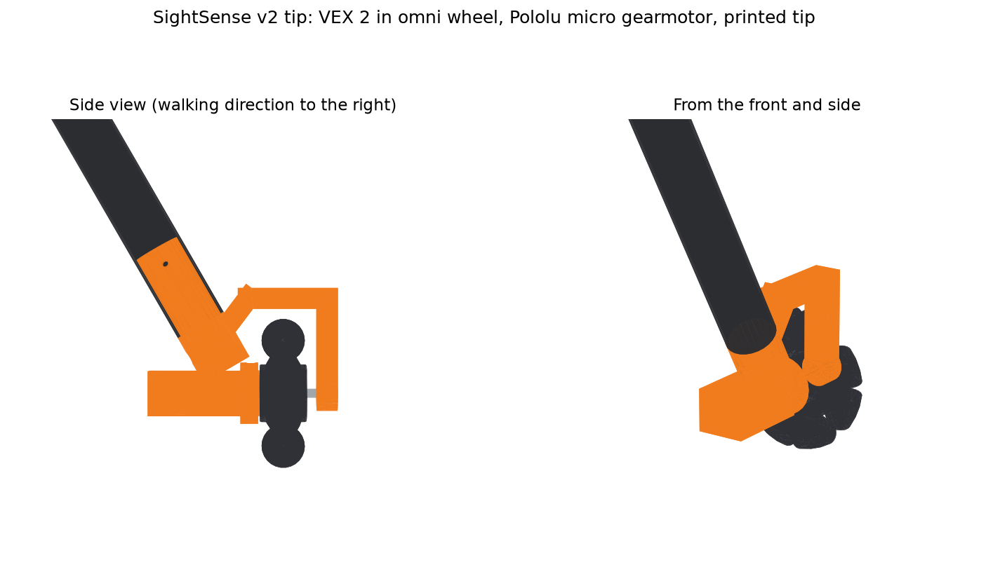

# Tip (v2)

The bottom of the cane, redone for v2: a VEX 2 in omni wheel (51 mm, 59% of v1's 85 mm wheel) on a Pololu micro metal gearmotor, held by one printed part that plugs into the lower carbon tube. It replaces v1's 12 V worm-gear motor, 85 mm wheel and [`../motor-mount-2/`](../motor-mount-2/).

Experimental prototype. Nothing here has been printed, fitted or tested. Strength and speed figures are estimates.

## How it works

- **The wheel's axle points along the walking direction.** Spinning the wheel pushes the cane's tip left or right; its rollers let the tip roll forward as you walk.
- **The motor drives it through a printed adapter.** The adapter fills the wheel's 1/2 in hex and clamps the motor's 3 mm D-shaft with an M3 set screw.
- **The wheel is held on both sides,** so your weight on the cane goes into the printed tip, not into the motor's 3 mm shaft. On the motor side the adapter's collar turns in a sleeve; on the far side the adapter turns on a 3 mm steel pin, held by an arm that goes over the top of the wheel. The arm also guards the wheel's front.
- **The cane's axis passes through the wheel's contact point,** with the cane leaning back 30° (the angle the handle is drawn for), so pressing down on the cane does not twist the tip.
- **The motor cannot go inside the wheel.** The wheel's centre is a 12.7 mm hex, smaller than the motor (12 × 10 mm, 15.6 mm corner to corner).

## The motor

Pololu 150:1 Micro Metal Gearmotor HP 6V (the same size and shaft as an N20), run from 5 V. Figures from Pololu's spec pages and dimension drawing:

| | |
| --- | --- |
| No-load speed | about 210 rpm at 6 V (about 175 rpm at 5 V, estimate) |
| Stall torque | 2.4 kg·cm at 6 V; Pololu advises staying under about 2 kg·cm in bursts |
| Stall current | 1.6 A at 6 V |
| Size | 12 × 10 mm, 25.8 mm long; 3 mm D-shaft, 10 mm long (Pololu's CAD) |

On the 2 in wheel at 5 V that is about 0.45 m/s and up to about 8 N of push (estimates). v1's motor on its 85 mm wheel managed about 0.53 m/s and about 6 N running, at ten times the weight and 12 V.

## Files

| File | What it is |
| --- | --- |
| `model.py` | The source, in build123d. It runs in the ftc-cad CAD workspace (project `sightsense-v2-tip`), which checks it and exports the files below. The wheel and the motor in it are the makers' own CAD: VEX's STEP for the 276-9044 wheel and Pololu's STEP for the micro metal gearmotor (`mmgm-pm.step`, from Pololu's "3D models of Micro Metal Gearmotors"). Those files stay in the CAD workspace; download them from VEX and Pololu to run the model elsewhere |
| `export/tip_motor_housing_sleeve_arm_tube_plug.stl` | The main printed part: motor housing, sleeve, arm and the plug that goes into the tube |
| `export/wheel_adapter_hex_to_3_mm_d.stl` | The adapter between the wheel and the motor |
| `export/rear_cap.stl` | Closes the back of the motor's tunnel; the motor's wires pass through it |
| `export/tip_print.3mf` | All three, laid out for printing |

## Buy

| Qty | Item |
| --- | --- |
| 1 | VEX 2 in omni-directional wheel, 276-9044 (sold in fours) |
| 1 | Pololu 150:1 Micro Metal Gearmotor HP 6V |
| 1 | 3 mm steel dowel pin, 20 mm |
| 1 | M3 × 6 set screw |

## Building it

1. Push the motor into its tunnel from the back until its gearbox stops against the front wall, with its wires out the back. Thread the wires through the rear cap and glue the cap in.
2. Glue the adapter into the wheel's hex, collar towards the motor.
3. Slide the wheel and adapter on: the collar goes into the sleeve and onto the motor's shaft. Turn it until the shaft's flat faces up, then tighten the set screw through the hole in the top of the sleeve.
4. Press the steel pin through the arm's boss into the adapter. A drop of oil helps the adapter turn on it.
5. Take the motor's wires up through the hole behind the neck and on up the tube. Tie the shock cord to the cross hole near the top of the plug, then glue the plug into the lower tube.

## Checks (from the model)

| Check | Result |
| --- | --- |
| Parts run into each other | None |
| Wheel to the tip's arm and sleeve | 0.6 mm at the closest |
| Housing above the ground | 17.7 mm; the wheel is the only thing that touches |
| Set screw on the shaft | 4.5 mm from its end; shaft 7.5 mm into the adapter |
| Arm with 60 N on the cane | about 10 MPa, printed lying on its side (PLA about 40 MPa along its layers): estimate |

## Still to check

1. That a 2 in omni wheel rolls and grips well on pavement, carpet and over cracks.
2. That the motor pushes hard enough to be felt through the cane.
3. The motor's real current at stall from a USB power bank.
4. That the arm stays stiff when the tip hits a kerb.
