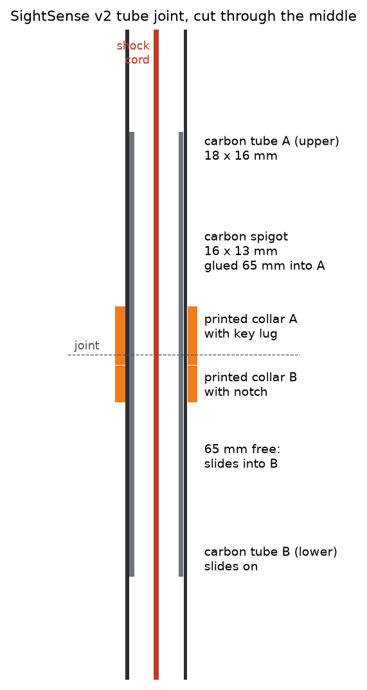

# Tube joint (v2)

The joint between the cane's two carbon tubes, redone because the v1 joint snapped. A thinner carbon tube inside the joint, like a tent pole's, takes the bending; two small printed collars only stop the sections twisting and keep the tube mouths from splitting. The cane still comes apart into its two sections, held together by the shock cord.

Experimental prototype. Nothing here has been printed, fitted or load tested. The strength figures are estimates from the model and from typical material values, not measurements.

## Why the v1 joint snapped

In [`../cane-coupler/`](../cane-coupler/) the tubes only butt end to end, and the one thing that crosses the joint is a printed tongue:

- **All the bending goes through plastic:** a 10 × 8.5 mm tongue, 20 mm long.
- **Its layer lines run across it** when printed standing up, which is plastic's weakest direction.
- **A 4.2 mm hole runs down its middle** for the cord, leaving walls of about 2 mm.
- **It has a sharp corner at its root,** where the bending is largest; on the motor end, the v4 cross-bolt hole takes more away.
- **It has 0.35 mm of play,** so it rattles and takes knocks.
- **The motor, wheel and battery sit far from the joint.** Lifting the cane by the handle puts an estimated 8 to 12 N·m on an upper joint; the tongue takes about 2 to 4 N·m ([`../joint-sleeve/`](../joint-sleeve/) works these out).

## How this one works

| Part | What it does |
| --- | --- |
| Carbon spigot | A 130 mm length of 16 × 13 mm carbon tube. Glued 65 mm into the upper tube; the other 65 mm slides into the lower tube. It carries all the bending across the joint |
| Collar A | Printed ring glued over the upper tube's end. Two lugs, one wide and one narrow, stick down past the joint |
| Collar B | Printed ring glued over the lower tube's end, with the two matching notches. The lugs stop the sections twisting, and only fit one way, so the wheel always ends up facing forward |
| Shock cord | 1/8 in, through both tubes and the spigot, pulls the sections together |

| | Estimate |
| --- | --- |
| Spigot, bending before it breaks | about 109 N·m (section modulus 218 mm³, assuming 500 MPa): about 9 times the 12 N·m load estimate, and about 27 times what the v1 tongue took |
| The outer carbon tube | about the same, 108 N·m (same assumption) |
| Spigot to tube clearance | 0.05 mm a side, after sanding its sliding half to 15.9 mm, in a 16.0 mm bore |

## Dimensions

| Feature | Value |
| --- | --- |
| Tubes | Two, 18 mm outside, 16 mm inside, 400 mm long: 800 mm of tube, half of v1's four |
| Spigot | Carbon tube 16 mm outside, 13 mm inside (1.5 mm wall), 130 mm long; the sliding half sanded to about 15.9 mm |
| Collars | 24 mm outside, 18.3 mm bore (0.15 mm a side for epoxy), 14 mm long |
| Key | Lugs 3 mm tall, 40° and 24° wide; notches 0.25 mm wider a side and 3.3 mm deep |

## Files

| File | What it is |
| --- | --- |
| `model.py` | The source, in build123d. It runs in Connor's ftc-cad CAD workspace (project `sightsense-v2`), which checks it and exports the files below; it does not run on its own here |
| `export/tube_joint.step` | The joint with both tubes, for CAD |
| `export/collar_a_keyed.stl`, `export/collar_b_notched.stl` | The two printed parts, standing as they print |

## Buy

| Qty | Item |
| --- | --- |
| 1 | Carbon tube, 16 mm outside, 13 mm inside, cut to 130 mm. Sold in 420 mm lengths, two to a pack, so one pack makes six |
| 1 | 1/8 in shock cord, as long as both tubes |
| — | Two-part epoxy |

## Building it

1. **Measure the 18 mm tubes' bore** with calipers. It should be 16.0 mm or a hair more; a 16 mm spigot then fits with no gap, so it will be tight.
2. Cut 130 mm off the 16 × 13 mm tube with a fine saw, wrapping the cut line in tape so the fibres do not splinter.
3. **Sand the sliding half** (65 mm from one end) with wet 400 grit until it slides into the 18 mm tube without forcing and without wobble. Sand wet and wear a mask: carbon dust is bad to breathe. Round both ends slightly so it slides in without catching.
4. Roughen the inside of the upper tube's end and the outside of the spigot's other half, then glue the spigot 65 mm into the upper tube.
5. Glue collar A over the upper tube's end and collar B over the lower tube's end, flush with the tube ends. Push the two together while the glue sets, so the lugs line up with the notches; keep glue off the spigot's free half.
6. Thread the shock cord through both tubes and tie it off at each end.

## Printing

These are suggestions, not tested settings.

- **Material:** PETG-CF or PLA. The collars carry only twisting and hoop loads, not the bending.
- **Orientation:** standing upright, as exported, no supports. Each prints in about 2 g.

## Still to check

1. The 18 mm tubes' real bore, against the 16 mm spigot.
2. That the joint does not wobble once the sliding half is sanded and the cord pulls it closed.
3. How it holds up when the cane is lifted, leaned on and knocked: a load test, with the result written here.
