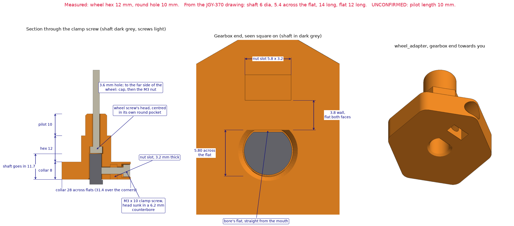

# Wheel adapter (v5)

A printed hub that puts the omni wheel onto the JGY-370 worm gearmotor's 6 mm D-shaft, so the wheel mounts directly on the motor. From the gearbox outwards it is a hexagonal collar, a 12 mm hex that drives the wheel, and a 10 mm round pilot that goes inwards through the wheel's centre hole. A small cap goes on the far side of the wheel.

Experimental prototype. This version has not been printed, fitted or load tested.

## What changed since the first print

An earlier version was test printed. M3 screws would not pass its 3.2 mm holes, and the motor bore did not fit well. Checking the model again also showed that the wheel screw's head could not sit centred at the bottom of the bore, because the bore's flat ran all the way down.

- Every screw hole is 3.6 mm.
- The bore follows the published shaft drawing, with a round pocket past the shaft tip for the wheel screw's head and a round passage for the head to get there.
- The collar is 28 mm across flats (was 22 mm), with the clamp screw's head sunk into it.
- The nut slot is 3.2 mm thick and sits 3.75 mm out from the bore, and the wall between them is flat on both faces. To allow that, the bore is D-shaped from its mouth, so the adapter starts where the shaft's flat starts.
- The parts are exported standing upright, so the bore and the wheel-screw hole print vertically.

## Where the sizes come from

| Size | Value | Source |
| --- | --- | --- |
| Wheel hex socket | 12 mm across flats | Measured by the team |
| Wheel centre hole | 10 mm | Measured by the team |
| Shaft | 6 mm diameter, 14 mm beyond the bosses, flat 12 mm long and 5.4 mm across | Published JGY-370 outline drawing; not measured on this motor |
| Pilot length | 10 mm | Estimate. It must be shorter than the 10 mm hole is deep |

One seller's photo gives the flat as 5.5 mm across. The bore takes either; the clamp screw takes up the slack. Print `wheel_adapter_fit_test.stl` first and try it on the shaft tip and in the wheel.

## Files

| File | What it is |
| --- | --- |
| `wheel_adapter.py` | build123d source. Running it exports the parts and runs the geometric checks; `--preview` also renders the drawing. It imports helpers from `../handle-phone-mount/`. |
| `export/wheel_adapter.stl` | The adapter, standing on its collar |
| `export/wheel_cap.stl` | Cap for the far side of the wheel; the nut tightens against it |
| `export/wheel_adapter_fit_test.stl` | Short hex and pilot with the bore through the hex, to check the fits |
| `export/*.step` | The same parts for CAD |

## Dimensions (from the source)

| Feature | Value |
| --- | --- |
| Bore | 6.3 mm diameter, 5.80 mm across the flat, D-shaped from the mouth |
| Passage for the wheel screw's head | 5.9 mm round, opposite the flat |
| Shaft engagement | 11.7 mm; the adapter starts 2.3 mm off the gearbox bosses |
| Head pocket | Round, 6.3 mm diameter, 3.3 mm deep, past the shaft tip |
| Hex for the wheel | 11.8 mm across flats, 12 mm long |
| Pilot | 9.8 mm diameter, 10 mm long, 0.8 mm chamfer on the end |
| Collar | Hexagon, 28 mm across flats, corners rounded 3 mm (31.4 mm over the corners), 8 mm long |
| Overall | 31.4 × 28.0 × 30.0 mm |
| Screw holes | 3.6 mm, for M3. The wheel-screw hole is 15 mm long |
| Nut slot | 5.8 × 3.2 mm, 3.75 mm out from the bore's flat |
| Clamp screw counterbore | 6.2 mm diameter, 2.0 mm of plastic between it and the nut slot |
| Cap | 20 mm flange, 3 mm thick, with a 4 mm long hex of 11.8 mm across flats |

The hex is longer than the wheel's socket is deep on purpose, so the step to the pilot seats in the socket.

## How it carries load

- **Torque:** the D-bore on the shaft's flat, then the hex into the wheel.
- **Bending:** the steel shaft runs through the collar and 3.7 mm into the hex. Past the shaft tip an M3 screw runs down the middle of solid plastic. No slot is cut into the hex or the pilot.
- **Pull-off:** an M3 screw through a captured nut presses on the shaft's flat. The wheel screw's head sits at the bottom of the bore, trapped behind the motor shaft, and its nut goes on the far side of the wheel, in the open.

## Hardware

| Qty | Item | Where |
| --- | --- | --- |
| 1 | M3 × 10 socket-head screw + M3 nut | Clamp onto the shaft's flat. It must be 10 mm: an 8 mm screw does not reach the shaft, and a 12 mm one sticks out of the collar towards the motor receiver |
| 1 | M3 socket-head screw + M3 nut | Holds the wheel on. 15 mm of it is inside the adapter; add the rest of the wheel, the cap and the nut |
| 1 | `wheel_cap`, the wheel kit's flanged piece, or a large washer | Under the nut, on the far side of the wheel |

## Assembly

1. Drop the wheel screw, head last, down the bore so its thread comes out of the pilot.
2. Push the wheel onto the hex and pilot, add the cap, and tighten the nut while holding the screw head with a hex key through the bore.
3. Slide the M3 nut into its slot from the gearbox end of the collar.
4. Slide the assembly onto the motor shaft and tighten the clamp screw onto the flat until it is snug. Only 2 mm of plastic backs the nut, so do not overtighten.

## Printing notes

These are suggestions, not tested settings.

- **Material:** PETG-CF, hardened nozzle.
- **Orientation:** standing on the collar's gearbox face, as exported, with no supports. The bore and the wheel-screw hole then print vertically and keep their shape. Layer lines run across the axis; the steel shaft and the wheel screw carry the bending. The cap prints flange down.
- **Walls and infill:** 100% infill, or 5 walls or more.

## Clearance to the motor receiver

With its M3 × 10 clamp screw fitted, the adapter passes 2.3 mm below the v4 motor receiver's band through a full turn (checked in the model against `../cane-coupler/`).

## Still to check

1. The fit of the bore on the motor shaft, with the fit-test piece.
2. The depth of the wheel's 10 mm hole and of its hex socket.
3. That the far side of the wheel has the same 12 mm hex socket. If not, use a washer instead of the cap.

## Note on the wheel design

`AGENTS.md` records the wheel decision as one motor steering a free-rolling wheel. This adapter mounts an omni wheel directly on the motor shaft instead. The decisions table has not been changed.
