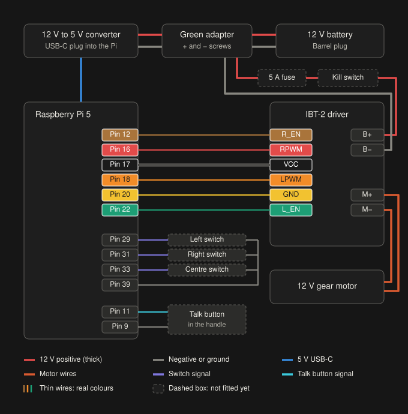
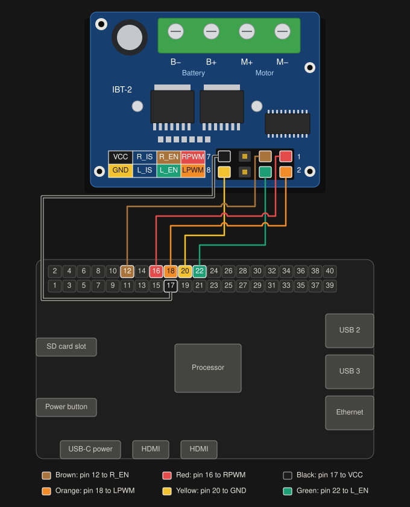
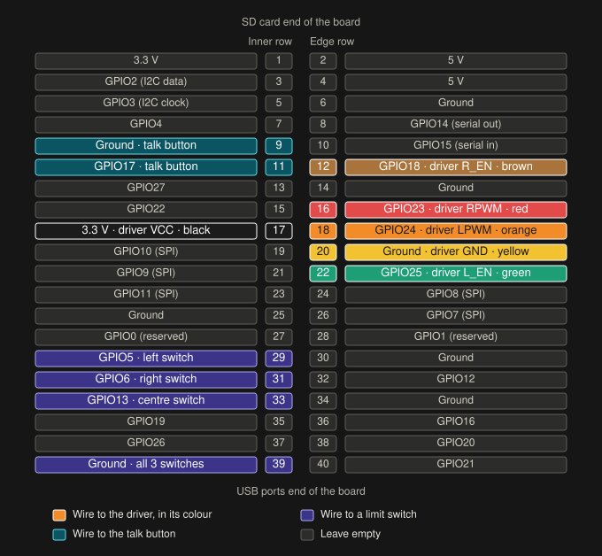
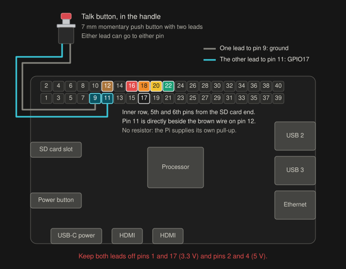

# Wiring

How the cane is wired, for the parts the team has. Power everything off before changing a wire.

The diagrams are drawn by [`diagrams/make_diagrams.py`](diagrams/make_diagrams.py). To change a wire's colour, change it in the table at the top and run the script again. Moving a wire to a different pin also means redrawing its path in the script.

## Status

As of the evening of October 10, 2026.

| Part of the wiring | State |
| --- | --- |
| Six wires, Pi end | Fitted. Read from photos; all six are on the pins on this page. |
| Six wires, driver end | Fitted. Read from photos by five independent readers, who all placed every wire on its planned pin, with the second column empty. Three checkers then tried to disprove that and could not. No photo shows a housing on a named pin: the columns are seen, the rows are worked out from the camera angle. Check black and yellow by eye before the first power-on. |
| Limit switches | Not fitted |
| Talk button | Wired. On October 11 at 10:57 AM the Pi logged real presses; see [`../pi/README.md`](../pi/README.md). Whether the phone was then running the build that listens for it is not known. |
| Fuse and kill switch | Not fitted |
| Battery, converter, motor | Not checked |
| Anything under power | Not tested |

Nothing on this page has been run with the motor yet.

October 11 update: the user reports the motor is connected directly to the mecanum wheel. Use `cane.py --wheel-drive`: LEFT/RIGHT spin opposite ways, CENTER/STOP/FREE switch off. This mode does not use the position switches or homing described below. The SD updater disables the previous full-power startup test. The physical left/right effect and RPM still need observation on the assembly.

## The whole thing



## Parts

| Part | Notes |
| --- | --- |
| Raspberry Pi 5 | In a case, with the active cooler fitted |
| Battery | 12 V 3 Ah Li-ion pack (3S1P), on a barrel plug lead |
| Motor driver | IBT-2 board (BTS7960). The plan said L298N; this is what the team has. |
| Motor | Greartisan 12 V 120 rpm worm gear motor |
| Converter | 12 V to 5 V, 5 A, with a USB-C plug. Powers the Pi from the same battery. |
| Barrel-to-screw adapter | The green one. This is where the battery's power splits two ways. |
| Jumper wires | Six, with a socket on each end |
| Limit switches | Three microswitches. Not fitted yet. |
| Talk button | 7 mm momentary push button with two leads, for the handle's nose. Wired on October 11. |
| Wire for the talk button | Two wires long enough to reach from the handle to the Pi, with a socket on the Pi end of each |
| Fuse and kill switch | 5 A fuse, and a switch rated for it. Not fitted yet. |

## Power

```
12 V battery ──► green screw adapter ──┬──► 12 V to 5 V converter ──► USB-C ──► Raspberry Pi 5
                                       │
                                       └──► fuse (5 A) ──► kill switch ──► IBT-2 B+
battery (−), at the adapter ──► converter (−) and IBT-2 B−
IBT-2 M+ and M− ──► motor
```

- Two wires go under each screw of the green adapter: one to the converter, one toward the IBT-2.
- Check which screw is positive with a multimeter before connecting anything else to the adapter (step 5 of the wiring order). A reversed battery will destroy the IBT-2.
- The fuse and kill switch are in the motor's branch only, so stopping the motor does not switch the Pi off.
- The kill switch must be within the user's reach. Until it is fitted, pulling the battery's barrel plug is the stop, and that switches the Pi off too.
- The IBT-2 has its own capacitor. No extra one is needed.
- The motor's two wires can go either way round on M+ and M−. `cane.py --swap` reverses the direction.

The earlier plan gave the Pi its own power bank, so the motor could not disturb it. If the Pi resets or reports under-voltage when the motor runs, go back to that.

## Pi to driver



GPIO numbers are BCM numbers, which is what the software uses. The header pin is the position on the Pi's 40-pin header.

| Wire on the cane | Pi header pin | What that pin is | IBT-2 pin | What it does |
| --- | --- | --- | --- | --- |
| Brown | 12 | GPIO18 | R_EN | Switches the driver on. Both enables must be on. |
| Red | 16 | GPIO23 | RPWM | Power signal for one direction |
| Black | 17 | 3.3 V | VCC | Supply for the driver's logic chip |
| Orange | 18 | GPIO24 | LPWM | Power signal for the other direction |
| Yellow | 20 | Ground | GND | Shared ground |
| Green | 22 | GPIO25 | L_EN | Switches the driver on. Both enables must be on. |

- Leave the driver's R_IS and L_IS pins empty.
- Black carries 3.3 V and yellow is ground here, which is not the usual convention. Go by this table, not by habit.
- VCC goes to the Pi's 3.3 V pin, not 5 V. The board's user guide lists VCC as +5 V, for a 5 V Arduino, and its control inputs as 3.3 to 5 V. Its buffer chip is a 74HC244, which only reads a 3.3 V signal within its guaranteed range when the chip itself runs on 3.3 V. This has not been tried on the team's board yet.

### The IBT-2's pins

Seen from above, with the screw terminals along the top edge and the 2 × 4 header at the bottom right:

| | Left | | | Right |
| --- | --- | --- | --- | --- |
| Top row | VCC | R_IS | R_EN | RPWM |
| Bottom row | GND | L_IS | L_EN | LPWM |

With the cane's wires fitted, that should be:

| | Left | | | Right |
| --- | --- | --- | --- | --- |
| Top row | black | empty | brown | red |
| Bottom row | yellow | empty | green | orange |

- The board prints the same eight names in a table to the left of the header, in the same rows and the same order. "7" and "8" are printed at the header's left end, "1" and "2" at its right end.
- Screw terminals, left to right starting beside the capacitor: B−, B+, M+, M−. The names are printed on the underside, next to the solder joints.

### Finding the Pi's pins



- Pin 1 is at the SD card end of the board, on the row nearer the middle. Pin 2 is beside it, on the row at the board's edge.
- Odd numbers run down the inner row, even numbers down the edge row. Pins 39 and 40 are at the USB ports end.
- Pins 12, 16, 18, 20 and 22 are close together on the edge row. Pin 17 is on the inner row, directly beside pin 18.
- Pins 9 and 11, for the talk button, are on the inner row. Pin 11 is directly beside pin 12.
- Pins 2 and 4 are 5 V. Nothing on the cane uses them. A wire from either to a GPIO pin can damage the Pi.

Three ways to check the Pi end by eye:

- On the edge row, nine empty pins lie between the green wire and the USB end.
- One empty pin lies between the red and brown wires.
- The black wire is on the inner row, directly beside the orange one.

## Limit switches

These inputs are for the earlier position-steering modes. Direct wheel drive does not open or read them.

Not fitted yet. Without them the controller cannot find left, centre or right. At start-up it gives six 0.4 second pulses, left and right, then switches the driver off. While commands keep arriving it rests 3 seconds and does the same again, about every 6 seconds.

| Pi header pin | What that pin is | Connects to |
| --- | --- | --- |
| 29 | GPIO5 | Left limit switch |
| 31 | GPIO6 | Right limit switch |
| 33 | GPIO13 | Centre limit switch |
| 39 | Ground | The other leg of all three switches |

- Use each switch's COM and NO legs: NO to the GPIO pin, COM to ground. The Pi's built-in pull-up holds the pin high, and pressing the switch pulls it low.
- Pins 25, 30 and 34 are also ground, if each switch gets its own ground wire.

## Talk button

Not fitted yet. A momentary push button in the handle's nose. Press it, then say a command: "what's in front of me", "take me to the grocery store".



| Pi header pin | What that pin is | Connects to |
| --- | --- | --- |
| 9 | Ground | One lead of the button |
| 11 | GPIO17 | The other lead |

- Either lead can go on either pin. A push button has no positive or negative side.
- No resistor. The Pi's built-in pull-up holds pin 11 high, and pressing the button pulls it to ground.
- Both pins are on the inner row, the 5th and 6th from the SD card end. Pin 11 is directly beside the brown wire on pin 12.
- Keep both leads off pins 1 and 17 (3.3 V) and pins 2 and 4 (5 V). A button between a supply pin and ground shorts the Pi's supply every time it is pressed.
- The button's own leads are short. Extend each with a wire long enough to reach from the handle to the Pi. Solder or crimp each join and cover it, so the two cannot touch each other or the carbon tube, which can conduct.
- Twist the two wires together and tape them to the tube. Leave a little slack at each joint if the cane comes apart there.

Check it before the Pi is powered, with a multimeter on continuity across the two sockets at the Pi end: silent until the button is pressed, a beep while it is held.

Then check it from the Pi. Nothing else needs to be connected:

```bash
python3 cane.py --bench button
```

Each press should print `talk button down`, then `talk button up` when it is let go.

How it works: the Pi tells the GX10 when the button goes down and up, the GX10 tells the phone to listen, and the phone sends back what it heard. The Pi does no listening. The messages are in [`../contracts/MESSAGES.md`](../contracts/MESSAGES.md).

If it ever reports presses by itself while the motor runs, the long wire is picking up noise. A 10 kΩ resistor between pin 11 and a 3.3 V pin makes the pull-up stronger. This has not been needed or tried.

## Wiring order

1. Unplug the Pi, unplug the battery, kill switch off.
2. The six wires from the Pi's header to the IBT-2's pins. The talk button's two leads to pins 9 and 11.
3. The three switches.
4. Motor to M+ and M−.
5. Find the adapter's positive screw. With only the battery plugged into the green adapter and no wires under its screws, set a multimeter to DC volts and put one probe on each screw. It should read about 12 V. If there is no minus sign, the red probe is on the positive screw. Mark that screw, then unplug the battery.
6. Battery still unplugged: the converter's positive wire to the marked screw and its negative wire to the other screw. Then the marked screw through the fuse and kill switch to B+, and the other screw to B−. Follow the wire from the marked screw by eye and check it ends at B+.
7. Leave the battery and the Pi unplugged. Do the checks in "Before the first power-on" next. Power goes on in "First tests from the Pi".

## Before the first power-on

Do these with everything unplugged.

1. Black is on the driver's top-row pin nearest the printed table, which is **VCC**, and yellow is on the bottom-row pin directly below it, which is **GND**. If these two are swapped, the Pi's 3.3 V supply is connected straight to ground when the Pi starts.
2. The second column of the driver's header from the printed table, R_IS and L_IS, is empty.
3. No wire is on Pi pin 2 or pin 4.
4. Nothing metal is touching the Pi's header or the underside of the driver. The driver's heatsink is metal.
5. Neither of the talk button's leads is on pin 1, 2, 4 or 17.
6. With a multimeter on continuity, if there is one: Pi pin 17 to driver VCC, and Pi pin 20 to driver GND. Then check there is no continuity between VCC and GND.
7. If the housings cover the driver's pins, use the screw terminals instead. Pi pin 6 (ground) to the driver's B− screw should beep. Pi pin 1 (3.3 V) to B− should not beep steadily; a short chirp that stops is fine. This relies on the driver's GND pin being joined to B− on the board, which is usual for an IBT-2 and has not been measured on this one.

## First tests from the Pi

Run these from `~/SightSense/pi` on the Pi.

Start with no 12 V at the driver, so nothing can move. If the kill switch is fitted, switch it off, then plug the battery in: that powers the Pi through the converter. Until the kill switch is fitted, one barrel plug feeds both the Pi and the driver, so leave it out and run the Pi from its own USB-C supply for steps 1 and 2. If the Pi runs from the converter with no kill switch, the driver has 12 V the whole time the Pi is on, including while it starts.

1. Check the Pi's power. `throttled=0x0` is good.

   ```bash
   vcgencmd get_throttled
   ```

2. Once the switches are fitted, press each one by hand and watch its name appear:

   ```bash
   python3 cane.py --bench switches
   ```

3. Give the driver 12 V: kill switch on, or plug the battery in if the kill switch is not fitted yet. Have the motor free to turn, not fitted to the steering, and a hand on the stop before you do. The Pi holds the driver off only while `cane.py` is running: not before it starts, and not after it ends. Watch the shaft for ten seconds first. It must stay still. Then run the test. It gives one 0.3 second pulse each way at 25% power and does not look at the limit switches:

   ```bash
   python3 cane.py --bench motor
   ```

   Watch for ten seconds after it ends, then take the 12 V away: kill switch off, or pull the battery plug. If the shaft ever turns with no program running, take the 12 V away at once and fit the two resistors in "Holding the driver off" below before going on. A still shaft is a good sign, not proof: a floating pin can change later.

4. For the current direct wheel, start `python3 cane.py --typed --wheel-drive`. It starts off. Type `left`, then `free`, then `right`, then `stop` and observe the fitted wheel's effect. Add `--swap` if left/right is reversed. The earlier position-steering command below homes immediately and is only for a mechanism with a steering axis and position switches. Give the driver 12 V just before the test and take it away after it ends; closing the controller releases its GPIO pins:

   ```bash
   python3 cane.py --typed
   ```

More on these in [`../pi/README.md`](../pi/README.md).

The earlier card setup enabled a full-power boot bench test. The October 11 SD updater removes its enable marker and cloud-init startup commands, and masks its service before enabling the direct wheel controller. The separate bench script remains documented in [`../pi/README.md`](../pi/README.md).

## If something is wrong

These are what to look at first. None has been needed yet, so none is proven.

| What happens | Look at |
| --- | --- |
| The Pi does not start, or restarts, with the driver connected | Black and yellow swapped at the driver; a wire on Pi pin 2 or 4; the Pi's supply |
| The motor does nothing on the motor test | Battery plugged in and kill switch on; polarity at B+ and B−; black on VCC; brown and green both seated, since the driver needs both enables |
| The motor turns one way only | The red or the orange wire, at either end |
| "Left" turns the wheel right | Add `--swap`, or swap the motor's two wires |
| The Pi restarts when the motor pulses | The Pi's power. Give it its own power bank. |
| Two switches read as pressed at once | A short between two switch wires, or a switch wired to NC instead of NO |
| "fault: could not reach" in the log | A switch not being pressed by the mechanism, or not wired |

## What damages the parts

- A 12 V wire touching any Pi pin.
- The battery connected backwards to the IBT-2.
- 5 V from anywhere onto a Pi GPIO pin.
- Black and yellow swapped at the driver, which shorts the Pi's 3.3 V supply.

## Limits to respect

- The IBT-2 passes the full 12 V and far more current than the motor needs, so the software limits are the only limits: motor power is capped at 25%, and each steering move is cut off after 0.4 seconds.
- No command from the GX10 for 0.4 seconds: motor driver off.
- These limits exist only while `cane.py` is running. Before it starts and after it ends, nothing limits the motor. Keep the 12 V off, kill switch off or battery unplugged, whenever `cane.py` is not running.
- The motor has a worm gear, so it holds its position when the power is off. With the driver off the steering stays where it was; it does not swing back to centre.
- Use the `gpiozero` library. `RPi.GPIO` and `pigpio` do not work on a Raspberry Pi 5.

## Holding the driver off

Not yet tried. When the controller exits, the Pi's motor pins go back to inputs with no pull, which was seen on the Pi. If the IBT-2 has no pull-downs of its own, floating enable pins may read as "on", and the motor then gets 12 V with no power cap and no time limit. Whether this board has pull-downs is not known. A 10 kΩ resistor from each of R_EN and L_EN to GND would hold the driver off whenever the Pi is not driving them. Fit them before the motor goes on the steering if the shaft ever moved with no program running in test 3.

## Where these facts come from

- The IBT-2's pin names, pin jobs and layout: the [Handson Technology user guide](https://cdn.hackaday.io/files/1936598285506656/BTS7960%20Motor%20Driver.pdf) (pin table, pin photo and mechanical drawing), and a photo of the team's own board.
- The Pi's header pins: gpiozero's board data for the Pi 5, which is what the `pinout` command prints.
- The wire colours: photos of the team's Pi and driver taken on October 10, 2026.
- The talk button's pins: chosen on October 11 because they are free, side by side, and one of them is a ground. The button's size is from its listing, as in [`handle-phone-mount/`](handle-phone-mount/).
